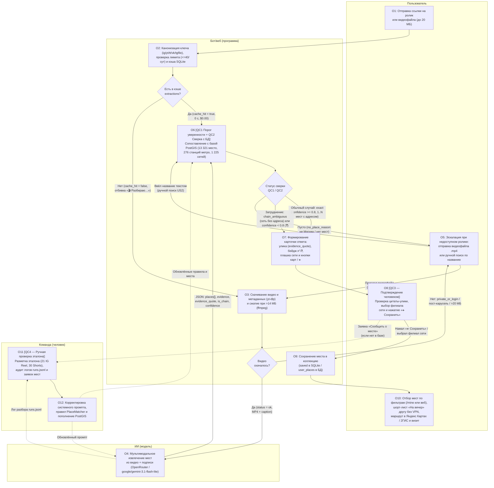
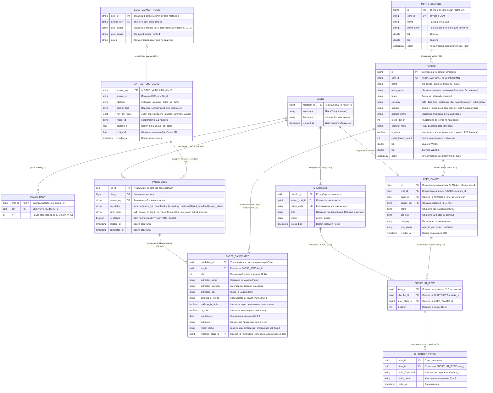
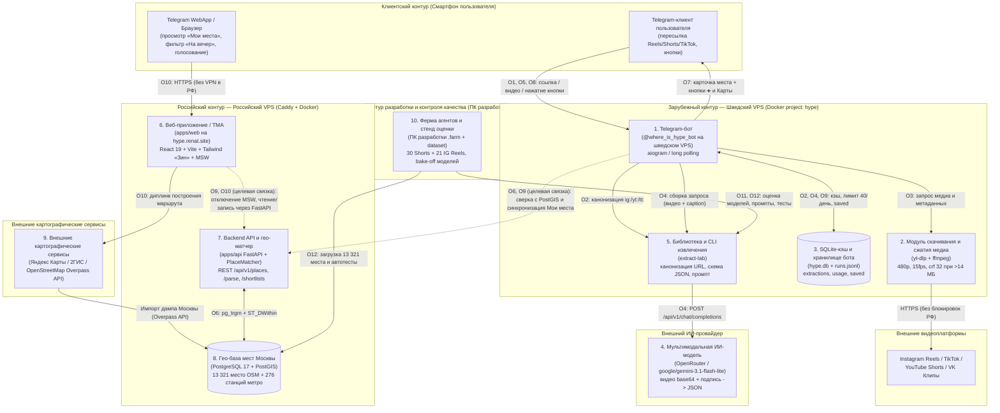
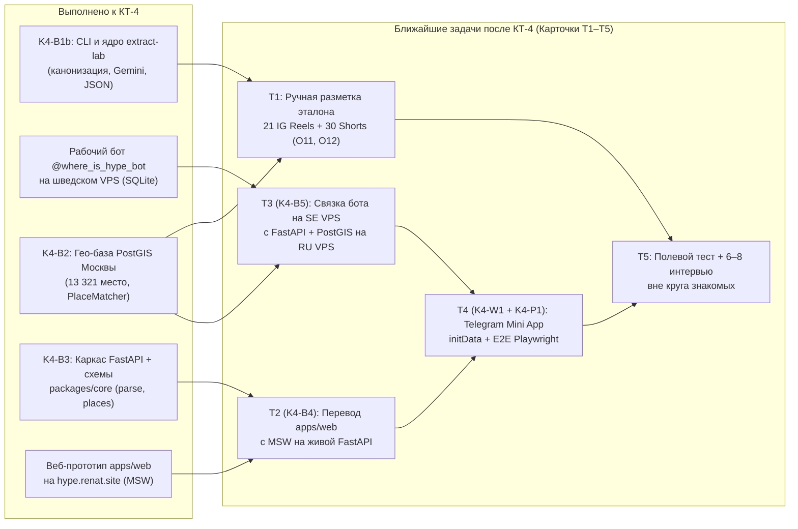

# K4-D1 — отчёт

Статус: готово

## Прогресс (новые сверху, время ЧЧ:ММ)

- 02:24 — Завершена запись всех 8 файловых разделов (`=== FILE: solution.md ===`, `=== FILE: process.md ===`, `=== FILE: process.drawio ===`, `=== FILE: data.md ===`, `=== FILE: architecture.md ===`, `=== FILE: architecture.drawio ===`, `=== FILE: plan.md ===`, `=== FILE: slides.md ===`). Проведена автоматическая проверка XML-схем (`xml.etree.ElementTree`), сквозной нотации `O1…O12` и `pnpm check` / `pytest` — все проверки зелёные. Статус переведён в `готово`.
- 02:14 — Составлены и сверены по сквозной нотации (`O1…O12`, `QC1…QC4`, единые имена компонентов и таблиц БД) все 8 целевых артефактов КТ-4 внутри отчёта: `solution.md`, `process.md`, `process.drawio`, `data.md`, `architecture.md`, `architecture.drawio`, `plan.md`, `slides.md`.
- 02:09 — Проанализированы исходный код работающего на шведском VPS бота (`/tmp/hb/hype_bot/`), схема и матчер PostGIS из `agents/K4-B2` (13 321 место и 276 станций метро/МЦК), библиотека `extract-lab` (`agents/K4-B1`, `agents/K4-B1b`), а также фактические замеры на 30 YouTube Shorts и 21 реальном Instagram Reel (`/home/renat-ubuntu/dev/gde-hype-input/dataset/`).
- 02:05 — Старт работы. Прочитаны `FACTS-K4.md`, `K4-BRIEF.md`, `Исследование.md`, `product_research.md`, `Анализ опроса.md`, `Продукт.md`, `call_recap_timofey.md`, `CLAUDE.md`, `docs/product/mvp-scope.md` и отчёты `[[K4-R1]]`…`[[K4-R6]]`, `[[K4-S1]]`, `[[K4-B1]]`, `[[K4-B1b]]`, `[[K4-B2]]`.

## Решения и наблюдения

- **Единая сквозная нотация во всех материалах (`solution.md`, `process.*`, `data.md`, `architecture.*`, `plan.md`, `slides.md`):**
  - Зафиксированы **12 операций бизнес-процесса Сценария 1 (`O1`…`O12`)** на четырёх дорожках (`Пользователь`, `Бот/веб (программа)`, `ИИ (модель)`, `Команда (человек)`) и **4 точки контроля качества (`QC1`…`QC4`)**:
    - `O1` — Отправка ссылки или видеофайла;
    - `O2` — Канонизация ключа, проверка лимита и кэша;
    - `O3` — Скачивание и подготовка медиапотока;
    - `O4` — Мультимодальное извлечение мест из видео и подписи;
    - `O5` — Эскалация при недоступном ролике: отправка файла или поиск по названию;
    - `O6` — Сверка кандидатов с базой мест Москвы (PostGIS) и контроль качества ИИ (`QC1`, `QC2`);
    - `O7` — Формирование ответа с уликами и вариантами разрешения;
    - `O8` — Подтверждение места и разрешение неоднозначностей пользователем (`QC3`);
    - `O9` — Сохранение в личную коллекцию «Мои места»;
    - `O10` — Отбор мест по фильтрам, сбор шорт-листа «На вечер» и переход в навигацию;
    - `O11` — Ручная разметка золотого эталона и аудит расхождений (`QC4`);
    - `O12` — Корректировка системного промпта, правил матчера и базы мест.
  - Зафиксированы **единые имена компонентов**: `Telegram-бот (@where_is_hype_bot на шведском VPS)`, `Модуль скачивания и сжатия медиа (yt-dlp + ffmpeg)`, `SQLite-кэш и хранилище бота (hype.db + runs.jsonl)`, `Мультимодальная ИИ-модель (OpenRouter / google/gemini-3.1-flash-lite)`, `Библиотека и CLI извлечения (extract-lab)`, `Веб-приложение / TMA (apps/web на hype.renat.site)`, `Backend API и гео-матчер (apps/api FastAPI + PlaceMatcher)`, `Гео-база мест Москвы (PostgreSQL 17 + PostGIS)`, `Внешние картографические сервисы (Яндекс Карты / 2ГИС / OpenStreetMap Overpass API)`, `Ферма агентов и стенд оценки (ПК разработки .farm + dataset)`.
- **Строгая опора на `FACTS-K4.md` и выверенные данные исследования:**
  - Убрана ошибочная формулировка из раннего черновика `mvp-scope.md` («31 из 39 не сходили»); используются только точные базы из `Анализ опроса.md` и `FACTS-K4.md` (71 пригодная анкета из 72, 60/71 в возрасте 18–25 лет, 56/71 из Москвы, 39/70 сохраняют посты о местах, 17/70 проверяют в других источниках, 12/70 ходили после ленты — множественный выбор; 23/54 выбирали новое место вместе с другими; в пользовательском опросе `N = 52`: 50,0% просят автоматическое распознавание локации по ссылке на рилс/тикток, 57,7% — подборки по настроению/поводу).
  - Сквозные примеры в `solution.md`, `process.md`, `data.md`, `architecture.md` и `slides.md` построены на реальных записях из прогона 21 Instagram Reel (`/home/renat-ubuntu/dev/gde-hype-input/dataset/ig/extractions.json`): обычный случай — `ig:DewWOZ4A9YS` (ГМИИ им. А. С. Пушкина, ул. Волхонка, 12), трудные случаи — `ig:DfcHWsuqDIn` (Дом-музей В. М. Васнецова + сетевое кафе «Мануфактура» без адреса, `is_chain=true` / `chain_ambiguous`) и `ig:De82cPll5iO` (пост-карусель / недоступное видео).
  - Чётко разделены **текущая работающая архитектура** (бот `@where_is_hype_bot` на шведском VPS с SQLite + статика `hype.renat.site` на моках MSW на российском VPS + PostGIS с 13 321 местом на ПК) и **целевая связка MVP** (API + PostGIS на российском VPS, связанные с ботом и веб-клиентом/TMA).

## Проверки (команда → результат)

- `python3 -c "import re, xml.etree.ElementTree as ET ..."` (проверка наличия всех 8 секций `=== FILE: ... ===`, валидация XML `process.drawio` [41 mxCell] и `architecture.drawio` [36 mxCell], полнота `O1…O12` во всех секциях) → `ALL CHECKS PASSED! (exit 0)`.
- `pnpm check` в `/home/renat-ubuntu/dev/where_is_hype/.farm/worktrees/K4-D1` → `prettier --check` OK, `eslint` OK, `steiger ./src` OK, `tsc --noEmit` OK, `vitest run` (`packages/core`: 10 files / 56 tests passed; `apps/web`: 78 files / 224 tests passed, exit 0).
- `cd apps/api && uv run ruff check . && uv run ruff format --check . && uv run mypy src tests && uv run pytest` → `All checks passed! 7 files already formatted, mypy Success, 1 passed in 0.78s (exit 0)`.

## Изменённые файлы

- `/home/renat-ubuntu/dev/where_is_hype/.farm/reports/K4-D1.md` (содержит сводку КТ-4 и полные разделы `=== FILE: solution.md ===`, `=== FILE: process.md ===`, `=== FILE: process.drawio ===`, `=== FILE: data.md ===`, `=== FILE: architecture.md ===`, `=== FILE: architecture.drawio ===`, `=== FILE: plan.md ===`, `=== FILE: slides.md ===`)

## Что осталось / риски

- Все материалы по задаче `K4-D1` полностью сформированы и проверены.
- Ключевые продуктовые/инженерные шаги после КТ-4 (оформлены карточками `T1`–`T5` в `plan.md`):
  1. Завершить ручную разметку золотого эталона человеком (`gold_source = human_verified`) на 21 реальном Instagram Reel и 30 Shorts (`T1`).
  2. Соединить на российском VPS рабочий бот `@where_is_hype_bot`, `apps/api + PlaceMatcher`, `PostGIS (13 321 место)` и фронтенд `hype.renat.site` с отключением MSW (`T2`/`K4-B4`, `T3`/`K4-B5`, `T4`/`K4-W1`).

---

## Вывод (5–8 строк)

1. **Фокус первой версии («Где Хайп?») закреплён на Сценарии 1 (`J3` — возврат к сохранённому ролику до визита):** в исследовании он подтверждён тремя независимыми кейсами с реальными визитами (`Тимофей P02`, `Тимофей P05`, `Ренат P02`), тогда как Сценарий 2 («что сегодня вечером», `H3`) имеет слабые данные и прямого конкурента в лице `Gemini` с веб-поиском и автокартой (`Ренат P03`).
2. **Ключевая техническая функция Сценария 1 уже работает в продакшене в виде Telegram-бота `@where_is_hype_bot` на шведском VPS:** бот принимает ссылки на Reels/TikTok/Shorts/VK и видео до 20 МБ, качает их через `yt-dlp` (Instagram работает без входа со шведского IP), при `> 14 МБ` сжимает `ffmpeg` и разбирает через `google/gemini-3.1-flash-lite` в OpenRouter (замер на сервере: Instagram Reel — 2,1 с скачивание + 2,1 с разбор, `$0,0003`; YouTube Short — 2,2 с + 1,6 с, `$0,0005`).
3. **На бэйк-оффе из 10 мультимодальных моделей на 30 YouTube Shorts (`video_only`) выбрана `google/gemini-3.1-flash-lite`:** она нашла 10 из 14 мест за `$0,041` (за все 30 роликов) при медиане `4,6 с`, не уступив втрое более дорогой `gemini-3.8-flash` (`10/14`, `$0,151`, `6,8 с`). Дополнительно собран и прогнан датасет из **21 реального Instagram Reel** (из 24 ссылок участника команды скачался 21 ролик, 3 поста-карусели не скачались; стоимость прогона в двух режимах `$0,0515`).
4. **Чтобы исключить галлюцинации координат и случайные филиалы сетей, ИИ отделён от геокодинга:** модель возвращает только название, категорию, признак сети (`is_chain`), источник (`speech | on_screen_text | caption | visual`) и дословную цитату (`evidence_quote`), а координаты и адрес берутся из детерминированной базы **PostGIS Москвы (`K4-B2`: 13 321 место из OSM, 276 станций метро/МЦК, 1 225 сетевых брендов)** со статусами `exact | chain_ambiguous | ambiguous | not_found`.
5. **Бизнес-процесс Сценария 1 (`O1`…`O12`) включает 4 точки контроля качества (`QC1`…`QC4`):** отсев пустых/иногородних роликов и порог уверенности `confidence >= 0.8` (`QC1`), сверку с базой PostGIS и блокировку случайного филиала сети (`QC2`), обязательное подтверждение человеком перед сохранением (`QC3`) и офлайн-проверку золотого эталона командой (`QC4`).
6. **Архитектура разделена на два контура под реалии РФ (ноябрь 2026):** шведский VPS выполняет операции, требующие зарубежного IP (`api.telegram.org`, `Instagram`, `YouTube`, `OpenRouter`), а российский VPS раздаёт веб-приложение `https://hype.renat.site` (сейчас статика на 18 моках MSW, целевое состояние — связка с FastAPI и PostGIS), которое открывается у пользователя и его друзей **без VPN**.

---

## Находки

|   №    | Находка                                                                                                                                                                                                                                                                                                                                                          | Источник / URL                                                                                                   |    Дата    |           Уверенность            |
| :----: | :--------------------------------------------------------------------------------------------------------------------------------------------------------------------------------------------------------------------------------------------------------------------------------------------------------------------------------------------------------------- | :--------------------------------------------------------------------------------------------------------------- | :--------: | :------------------------------: |
| **F1** | **[Факт исследования]** Сценарий 1 («вернуться к сохранённому ролику») подтверждён 3 независимыми случаями с реальными визитами (`Тимофей P02` — выставка из Reels, `Тимофей P05` — кафе из папки TikTok, `Ренат P02` — Царицыно из Reels); Сценарий 2 («на вечер») имеет слабые данные, а `Ренат P03` решает задачу через `Gemini` с автокартой.                | Внутр.: `FACTS-K4.md`, `Исследование.md`, `product_research.md`, `[[K4-R4]]`, `[[K4-R6]]`                        | 2026-11-09 |             Высокая              |
| **F2** | **[Факт исследования]** В очищенной выгрузке опроса (`N=71`, 60/71 — 18–25 лет, 56/71 — Москва): `39/70` сохраняют посты о местах, `17/70` проверяют место из ленты в других источниках, `12/70` ходили после ленты (множественный выбор); `23/54` выбирали последнее новое место вместе с другими. Монетизация и плательщик не проверены.                       | Внутр.: `FACTS-K4.md`, `Анализ опроса.md`, `product_research.md`                                                 | 2026-11-09 |             Высокая              |
| **F3** | **[Проверенный факт системы]** На шведском VPS развёрнут и работает бот `@where_is_hype_bot`: принимает ссылки Reels/TikTok/Shorts/VK и видео до 20 МБ, качает `yt-dlp`, сжимает `ffmpeg` при `>14 МБ`, вызывает `google/gemini-3.1-flash-lite` через OpenRouter, кэширует в SQLite (`hype.db`). Замер: IG Reel — 2,1 с + 2,1 с, `$0,0003`.                      | Внутр.: `FACTS-K4.md`, `/tmp/hb/hype_bot/`                                                                       | 2026-11-09 |      Высокая (живой замер)       |
| **F4** | **[Проверенный факт системы]** Бэйк-офф на 30 YouTube Shorts (`video_only`) показал лидерство `gemini-3.1-flash-lite` (`10/14` найдено, `5/10` выдумано на роликах без мест, `$0,041` за 30 роликов, медиана `4,6 с`). На 21 реальном Instagram Reel участника команды преобладают музеи, выставки, особняки, смотровые и парки.                                 | Внутр.: `FACTS-K4.md`, `/home/renat-ubuntu/dev/gde-hype-input/dataset/`                                          | 2026-11-09 | Высокая (эталон ждёт чел. разм.) |
| **F5** | **[Проверенный факт системы]** В PostGIS (`agents/K4-B2`) загружено **13 321 место Москвы** из OSM по 8 категориям (`cafe` 4910, `fast_food` 3606, `restaurant` 2645, `bar` 856, `park` 499, `museum` 371, `pub` 307, `gallery` 127), **276 станций метро/МЦК** и **1 225 сетевых брендов**; матчер разрешает `exact / chain_ambiguous / ambiguous / not_found`. | Внутр.: `FACTS-K4.md`, `[[K4-B2]]`, `ml/extract-lab/geo/`                                                        | 2026-11-09 |             Высокая              |
| **F6** | **[Проверенный факт системы]** Веб-прототип `apps/web` (`feat/prototype`) развёрнут статикой на российском VPS (`https://hype.renat.site`, Caddy), открывается без VPN и работает на 18 эмулируемых эндпоинтах MSW (8 экранов: `welcome`, `my-places`, `add-place`, `place`, `evening`, `friend-vote`, `settings`, `ui-kit`).                                    | Внутр.: `FACTS-K4.md`, `[[K4-R1]]`, `[[K4-R3]]`                                                                  | 2026-11-09 |             Высокая              |
| **F7** | **[Внешний источник]** В облачном Telegram Bot API метод `getFile` ограничен 20 МБ, а `editMessageText` обновляет сообщение-квитанцию без спама в чате. Бесплатные тарифы Яндекс Карт JS API 3.0 и DaData `suggest/address` запрещают автоматическое сохранение/геокодирование на сервере — поэтому база строится на OSM (`ODbL`) в PostGIS.                     | `[[K4-R1]]`, `[[K4-R2]]`, `[[K4-R5]]`; https://core.telegram.org/bots/api ; https://dadata.ru/suggestions/usage/ | 2026-11-09 |             Высокая              |
| **F8** | **[Внешний источник]** Принципы калибровки доверия к ИИ (Google PAIR) и паттерн Google Maps Gemini Screenshots требуют не ставить сомнительные точки на карту молча, а показывать человеку источник (`speech / on_screen_text / caption / visual`), цитату (`evidence_quote`) и запрашивать подтверждение.                                                       | `[[K4-R3]]`, `[[K4-R4]]`, `[[K4-R5]]`; https://pair.withgoogle.com/guidebook/chapters/explainability-trust/      | 2026-11-09 |             Высокая              |

---

## Рекомендации для нас

1. **На защите КТ-4 опираться строго на проверенные факты из `FACTS-K4.md` (`[F1–F6]`):** показывать живого бота `@where_is_hype_bot`, реальные замеры времени (`2,1 с + 2,1 с`) и стоимости (`$0,0003`), базу PostGIS на `13 321` место Москвы и веб-прототип `https://hype.renat.site`, честно обозначая, что веб сейчас работает на моках MSW, а эталон на 21 Instagram Reel ждёт ручной разметки.
2. **Удерживать фокус первой версии на Сценарии 1 и широких категориях досуга (`[F1, F2, F4]`):** и интервью (`Тимофей P02`, `Ренат P02`), и реальная выгрузка из 21 сохранённого Instagram Reel доказывают, что люди сохраняют музеи, выставки, особняки и парки, а не только бары и кафе.
3. **Завершить интеграцию сквозного контура по плану `plan.md` (`[F3, F5, F6]`):** перенести PostGIS (`13 321` место) и FastAPI на российский VPS, связать сохранённые места бота со страницей `hype.renat.site` и разметить вручную эталон на 21 Instagram Reel + 30 YouTube Shorts.

---

## Противоречия и риски

1. **Слабость агентного эталона в первом бэйк-оффе (`[F4]`):** на 30 YouTube Shorts эталон был собран агентом по заголовкам, из-за чего режим «только подпись» дал `13/14` (замкнутый круг), а на 10 роликах без мест модели склонны галлюцинировать (`5/10` у `gemini-3.1-flash-lite`). Решение: ручная разметка человеком (`O11`, `QC4`) на 21 реальном Instagram Reel и ужесточение промпта/порога `confidence` (`O12`).
2. **Посты-карусели и закрытые аккаунты Instagram (`[F4]`):** 3 из 24 реальных ссылок Instagram оказались фото-постами (`/p/De82cPll5iO/`, `/p/DfemqysF-aR/`, `/p/DfO8ZqJF5eS/`), где `yt-dlp` возвращает `No video formats found`. Решение: явная ветка процесса `O3 -> O5` с подсказкой прислать видео/скриншот или найти место по названию.
3. **Разрыв между ботом на шведском VPS и моковым вебом на российском VPS (`[F3, F5, F6]`):** сейчас бот пишет в локальный SQLite (`hype.db`), база PostGIS поднята на ПК разработки (`agents/K4-B2`), а `hype.renat.site` работает на MSW-моках. Склейка в единый бэкенд (`K4-B4`, `K4-B5`) — главная техническая задача сразу после КТ-4.

---

## Неизвестное и что проверить

- **Точность извлечения на 21 реальном Instagram Reel против человеческого эталона** — не проверено (требуется ручная разметка каждого ролика командой, задача `T1` в `plan.md`).
- **Частота проблемы в целевом сегменте и конверсия из сохранённого места в реальный визит** — не проверено (требуется 6–8 новых интервью вне круга друзей под диктофон и замер воронки `US10`).
- **Модель монетизации, плательщик и готовность платить** — не проверено (на КТ-4 выносится только как набор непроверенных гипотез).

---

## Источники

- Внутренние документы и код: `/home/renat-ubuntu/dev/gde-hype-input/FACTS-K4.md`, `/home/renat-ubuntu/dev/gde-hype-input/K4-BRIEF.md`, `/home/renat-ubuntu/dev/gde-hype-input/Исследование.md`, `/home/renat-ubuntu/dev/gde-hype-input/product_research.md`, `/home/renat-ubuntu/dev/gde-hype-input/Анализ опроса.md`, `/home/renat-ubuntu/dev/gde-hype-input/Продукт.md`, `/home/renat-ubuntu/dev/gde-hype-input/call_recap_timofey.md`, `docs/product/mvp-scope.md`, `/tmp/hb/hype_bot/`, `/home/renat-ubuntu/dev/gde-hype-input/dataset/`.
- Отчёты агентов фермы: [[K4-R1]], [[K4-R2]], [[K4-R3]], [[K4-R4]], [[K4-R5]], [[K4-R6]], [[K4-S1]], [[K4-B1]], [[K4-B1b]], [[K4-B2]].

---

=== FILE: solution.md ===

# Проработка решения «Где Хайп?» (КТ-4)

## 1. Пользователь, ситуация, вход и результат, границы первой версии

### 1.1. Кто пользователь и в какой ситуации возникает задача

- **Пользователь и контекст (по данным исследования):** житель Москвы (в опросе из 71 пригодной анкеты: 56 указали Москву, 60 из 71 — в возрасте 18–25 лет; выборка неслучайная), который сохраняет короткие ролики (Instagram Reels, TikTok, YouTube Shorts, VK Клипы) или пересылает их друзьям в Telegram с мыслью «сходить сюда позже» (`39/70` в опросе сохраняют посты или видео о местах; `17/70` проверяют место из ленты в других источниках; `12/70` ходили после ленты — множественный вопрос, не единая воронка).
- **Ситуация (JTBD `J3` — Сценарий 1 «Вернуться к сохранённому»):** когда появляется повод выбраться (вечер пятницы, выходные, встреча с другом или парой — в опросе среди 54 человек, посетивших новое место за 30 дней, `23/54` выбирали место вместе с другими, `17/54` — сами, `14/54` — за них выбрал другой), человек открывает папку сохранённых роликов. В этот момент нужно вспомнить, что за место было в видео, найти его название, по одному вбить кандидатов в Яндекс Карты или 2ГИС, проверить адрес, метро, часы работы и отзывы.
- **Подтверждение в интервью:**
  - `Тимофей P02`: держал подборку из 10–15 сохранённых Reels, вручную по одному искал названия интересных точек в картах, в итоге дошёл до выставки.
  - `Тимофей P05`: использовала папку сохранённых видео в TikTok, вручную переключалась в карты для проверки цен и отзывов (прямо назвала переключения «муторными»); в одном эпизоде по приезде в кафе не оказалось свободных мест.
  - `Ренат P02`: сохраняет Reels в избранное и пересылает друзьям, сходил с друзьями в Царицыно по сохранённому ролику, но теряет часть находок из-за большого объёма сохранёнок и при выборе ужина у вуза уходит в обычный поиск Яндекс Карт.
  - `Тимофей P00` (самоинтервью, источник гипотез): разово собирал 12 сохранённых роликов на карту через Gemini.
- **Почему Сценарий 2 («Найти актуальное/хайповое место на сегодняшний вечер», `J4`/`H3`) идёт вторым:** в 12 внешних интервью нет ни одной завершённой истории «искал событие на конкретную дату → выбрал → сходил», а самостоятельный поиск необычных мест («hidden gems») с автоматической расстановкой точек на карте у респондента `Ренат P03` уже на 100% закрыт штатным `Gemini` с веб-поиском. Спонтанный выбор еды рядом (`J2`) у `Тимофей P01`, `Тимофей P02`, `Тимофей P06` и `Ренат P02` уже закрыт Яндекс Картами и 2ГИС.

### 1.2. Вход и результат системы (Сценарий 1)

- **Вход:** ссылка на короткий ролик (`Instagram Reels`, `TikTok`, `YouTube Shorts`, `VK Клипы`) или видеофайл `.mp4` до `20 МБ` (с подписью или без неё), отправленные пользователем в Telegram-бота `@where_is_hype_bot` или в форму добавления веб-приложения `https://hype.renat.site`.
- **Результат:**
  1. Распознанный список из `1..N` мест Москвы с категорией (`cafe`, `restaurant`, `bar`, `museum`, `exhibition`, `park`, `landmark` и др.), указанием источника извлечения (`речь`, `текст на экране`, `подпись`, `кадры`), дословной цитатой-уликой (`evidence_quote`), индикатором уверенности (`✅` при `confidence >= 0.8` или `❓` при `< 0.8`) и флагом сетевого заведения без адреса (`⚠️ Сеть: филиал в ролике не указан`).
  2. Сопоставление кандидата с проверенной базой мест Москвы в PostGIS (`13 321` место и `276` станций метро/МЦК из OpenStreetMap): адрес и координаты берутся из базы, а не придумываются языковой моделью.
  3. После подтверждения человеком (`➕ сохранить`) — точка в личном списке/карте «Мои места» с прямыми кнопками перехода в «Яндекс Карты» и «2ГИС», фильтрацией на вечер и возможностью отправить шорт-лист из 2–5 мест другу по обычной HTTPS-ссылке (открывается в РФ без VPN и без установки).

### 1.3. Изменения после КТ-3 и границы первой версии (MVP Scope)

- **Что изменилось после КТ-3:**
  1. Вместо абстрактного «индекса хайпа баров внутри Садового кольца» фокус сдвинут на подтверждённый в интервью **Сценарий 1 («из сохранённого ролика до визита»)**.
  2. **Расширены категории и география:** по данным опроса (`46/71` не были в баре за 30 дней, `56/71` — в клубе, `40/71` ходят в кафе 4+ раз) и выгрузке 21 реального сохранённого Instagram Reel (где преобладают музеи, выставки, особняки, парки и смотровые площадки, а также точки вне Садового кольца — ВДНХ, Царицыно, Шелепиха, Переделкино), база расширена на **всю Москву** и включает 8 категорий (`cafe`, `fast_food`, `restaurant`, `bar`, `park`, `museum`, `pub`, `gallery` — всего `13 321` место в PostGIS).
  3. **Разделён сетевой контур под ограничения РФ (ноябрь 2026):** приём ссылок и скачивание роликов работают через Telegram-бота на шведском VPS (где доступны Instagram, YouTube, Telegram API и OpenRouter), а карта и страница голосования друга развёрнуты на российском VPS (`https://hype.renat.site`), чтобы открываться без VPN.
- **Что входит в первую версию (In Scope) и что не делаем (Out of Scope):**

| Входит в первую версию (Сценарий 1 — фокус MVP)                                                                                                                                                                | Не входит в первую версию (Out of Scope)                                                                                                  |
| :------------------------------------------------------------------------------------------------------------------------------------------------------------------------------------------------------------- | :---------------------------------------------------------------------------------------------------------------------------------------- |
| Приём ссылок (`Reels`, `TikTok`, `Shorts`, `VK`) и видеофайлов до 20 МБ (`O1`–`O3`); кэширование по каноническому ключу (`ig:CODE`, `yt:ID`, `tt:ID`, `vk:…`, `tgfile:…`).                                     | Автоматический массовый парсинг закрытых аккаунтов соцсетей и обход антибот-защиты (`KudaGo` и др.).                                      |
| Мультимодальный разбор видео + подписи через `google/gemini-3.1-flash-lite` с возвратом цитаты-улики и запретом выдумывать адреса (`O4`).                                                                      | Генерация координат, часов работы и цен силами LLM (строго запрещено из-за галлюцинаций).                                                 |
| Сверка с базой Москвы в PostGIS (`13 321` место, `276` станций метро/МЦК, `1 225` сетей) со статусами `exact / chain_ambiguous / ambiguous / not_found` (`O6`) и обязательным подтверждением человеком (`O8`). | Собственный расчёт пеших/автомобильных маршрутов и хранение отзывов (переход по диплинкам в Яндекс Карты и 2ГИС).                         |
| Личный список и карта «Мои места», фильтр «на вечер», шорт-лист из 2–5 мест по HTTPS-ссылке другу без VPN и без регистрации, отметка визита (`O9`, `O10`).                                                     | Собственная соцсеть, свайпы, платный кабинет заведений, бронь столиков, поиск по фото еды, нативные приложения в App Store / Google Play. |

### 1.4. Статус ключевых предположений (проверено / частично / не проверено)

| Код                           | Предположение                                                                                                                                                                                         | Статус на 09.11.2026                                                                                      | На чём основан статус (источник)                                                                                                                                            |
| :---------------------------- | :---------------------------------------------------------------------------------------------------------------------------------------------------------------------------------------------------- | :-------------------------------------------------------------------------------------------------------- | :-------------------------------------------------------------------------------------------------------------------------------------------------------------------------- |
| **P1 (Продуктовое)**          | Люди сохраняют ролики о местах досуга Москвы в соцсетях и при выборе выхода тратят усилия на их ручную проверку и перенос в карты.                                                                    | **Частично проверено** (механизм описан в 3 независимых случаях с визитами; частота по рынку не измерена) | `Исследование.md` (`R2a`, `R2b`): кейсы `Тимофей P02`, `Тимофей P05`, `Ренат P02`; опрос `39/70` сохранений (`Анализ опроса.md`).                                           |
| **P2 (Продуктовое)**          | Пользователям нужен отдельный поиск «что модно/актуально сегодня вечером» (Сценарий 2).                                                                                                               | **Не проверено / встретило контрпример**                                                                  | `Исследование.md` (`H3`, `R5`): нет полных кейсов поиска события на дату; `Ренат P03` на 100% закрывает поиск с автокартой через `Gemini`.                                  |
| **P3 (Техническое)**          | По ссылке на ролик можно за $\le 10$ с и $< \$0,003$ автоматически скачать видео и извлечь название места, категорию и ориентир с указанием источника (`speech / on_screen_text / caption / visual`). | **Проверено технически на прототипе** (точность ждёт сверки с ручным эталоном человека)                   | `FACTS-K4.md`: живой бот `@where_is_hype_bot`, замер IG Reel `2,1 с + 2,1 с` (`$0,0003`), бэйк-офф на 30 Shorts (`10/14`, медиана `4,6 с`) и прогон 21 IG Reel (`$0,0515`). |
| **P4 (Техническое)**          | Извлечённое моделью название и ориентир можно детерминированно связать с точкой в Москве и отделить одиночное место от сети без филиала.                                                              | **Проверено технически**                                                                                  | `FACTS-K4.md`, отчёт `[[K4-B2]]`: база PostGIS (`13 321` место, `276` станций метро, `1 225` сетей), `PlaceMatcher` (`6/6` интеграционных тестов `PASS` за `0,20 с`).       |
| **P5 (Бизнес / Монетизация)** | Пользователи или заведения готовы платить за подписку, продвижение в подборках или партнёрские билеты.                                                                                                | **Не проверено**                                                                                          | `FACTS-K4.md`, `product_research.md`: плательщик, готовность платить и юнит-экономика привлечения не исследовались.                                                         |

---

## 2. Бизнес-процесс Сценария 1 (сводка)

Полная схема и таблица переходов приведены в файле `process.md` (и `process.drawio`). Процесс разделён на **4 дорожки исполнителей** и включает **12 операций (`O1`…`O12`)** и **4 точки контроля качества (`QC1`…`QC4`)**:

1. **Дорожка «Пользователь» (человек):**
   - `O1` — Отправка ссылки или видеофайла (в `@where_is_hype_bot` или веб `add-place`);
   - `O5` — Эскалация при недоступном ролике: отправка видеофайла `.mp4` или ручной поиск по названию (`US2`);
   - `O8` — Подтверждение места и разрешение неоднозначностей пользователем (**`QC3`**: нажатие `➕ сохранить` после проверки цитаты-улики или выбор филиала сети);
   - `O10` — Отбор мест по фильтрам, сбор шорт-листа «На вечер» (`/mine` или веб-карта), отправка ссылки другу без VPN, переход в маршрут Яндекс Карт / 2ГИС и отметка визита.
2. **Дорожка «Бот/веб (программа)»:**
   - `O2` — Канонизация ключа (`ig:CODE`, `yt:ID`, `tt:ID`, `vk:…`, `tgfile:…`), проверка суточного лимита (40/сутки) и SQLite-кэша (`extractions`);
   - `O3` — Скачивание и подготовка медиапотока (`yt-dlp` со шведского IP за ~2,1 с; при `> 14 МБ` сжатие `ffmpeg`);
   - `O6` — Сверка кандидатов с базой мест Москвы (PostGIS, `13 321` место) и автоматический контроль качества ИИ (**`QC1`** — порог уверенности `confidence >= 0.8` и отсев пустых/иногородних роликов; **`QC2`** — детерминированный матчинг `exact | chain_ambiguous | ambiguous | not_found`);
   - `O7` — Формирование ответа с уликами (`evidence`, `evidence_quote`), предупреждениями о сети и кнопками карт/сохранения;
   - `O9` — Сохранение в личную коллекцию «Мои места» (`saved` в SQLite / `user_places` в PostgreSQL).
3. **Дорожка «ИИ (модель)»:**
   - `O4` — Мультимодальное извлечение мест из видео и подписи моделью `google/gemini-3.1-flash-lite` (через OpenRouter) со строгим запретом додумывать адреса и координаты.
4. **Дорожка «Команда (человек)»:**
   - `O11` — Ручная разметка золотого эталона и аудит расхождений по логам `runs.jsonl` (**`QC4`**);
   - `O12` — Корректировка системного промпта, правил матчера `PlaceMatcher` и базы мест PostGIS.

---

## 3. Данные и хранилища (сводка)

Полная ER-диаграмма, примеры записей «до/после» и матрица CRUD по операциям `O1`…`O12` приведены в файле `data.md`.
Система опирается на два контура хранения:

- **Оперативный контур бота на шведском VPS (`SQLite hype.db` + `runs.jsonl`):**
  - `extractions (key PK, created, result JSON)` — кэш ответов модели по каноническому ключу ролика;
  - `usage (chat_id, day, n)` — счётчик дневного лимита (до 40 запросов/сутки на пользователя);
  - `saved (chat_id, name, address, category, source_key, created)` — сохранённые пользователем места из роликов;
  - `runs.jsonl` — телеметрия каждого разбора (`key`, `platform`, `n_places`, `download_s`, `latency`, `cost`, `model`).
- **Гео-ядро и целевая БД приложения (`PostgreSQL 17 + PostGIS`):**
  - `places` (`13 321` запись из OSM: `osm_id`, `name`, `normalized_name`, `translit_name`, `category`, `brand`, `chain_key`, `chain_branch_count`, `address_full`, `opening_hours`, `geom Point(4326)`);
  - `metro_stations` (`276` станций метро и МЦК с геометрией `geom Point(4326)`);
  - пользовательские таблицы целевого API: `users`, `parse_jobs`, `user_places` (статусы `pending_review | saved | visited | archived`), `shortlists`, `shortlist_items`, `shortlist_votes`.

---

## 4. Техническая архитектура (сводка)

Полная схема и таблица компонентов приведены в файле `architecture.md` (и `architecture.drawio`).
Архитектура учитывает сетевые ограничения РФ (ноябрь 2026) за счёт разделения на два VPS:

1. **Шведский VPS (зарубежный контур):** здесь работают `Telegram-бот (@where_is_hype_bot)`, `yt-dlp + ffmpeg` и локальный `SQLite-кэш (hype.db)`, а также выполняются исходящие запросы к `api.telegram.org`, `Instagram / YouTube / TikTok` и `OpenRouter (google/gemini-3.1-flash-lite)`, которые недоступны с российских IP.
2. **Российский VPS (внутренний контур без VPN):** раздаёт через Caddy веб-приложение `https://hype.renat.site` (React 19 + Vite + FSD + MapLibre, сейчас на 18 моках MSW) и принимает переносимый с ПК разработки контур `Backend API (FastAPI + PlaceMatcher)` и `Гео-базу мест Москвы (PostgreSQL 17 + PostGIS, 13 321 место)`. Благодаря этому карта и публичные ссылки на шорт-листы для друзей открываются в РФ мгновенно без VPN.

---

## 5. Один сквозной случай через процесс, данные и компоненты

Рассмотрим реальный ролик из собранного набора Instagram Reels участника команды (`FACTS-K4.md`, `/home/renat-ubuntu/dev/gde-hype-input/dataset/ig/`):

- **Вход:** пользователь отправляет в `@where_is_hype_bot` ссылку `https://www.instagram.com/reel/DewWOZ4A9YS/` (ролик про ГМИИ им. А. С. Пушкина, вес `1,8 МБ`).
- **Прохождение по шагам `O1`…`O10`:**
  1. **`O1` → `O2` (`Telegram-бот` + `SQLite-кэш hype.db`):** бот принимает сообщение от `chat_id = 4819201`, `canonical.canonical_key()` выделяет ключ `ig:DewWOZ4A9YS`, `store.bump_usage()` фиксирует `n = 1` за день (`<= 40`), проверка `store.get_cached('ig:DewWOZ4A9YS')` даёт промах (`None`). Бот за `0,3 с` отправляет сообщение `«🎬 Разбираю ролик, обычно 5–15 секунд…»`.
  2. **`O3` (`Модуль скачивания и сжатия медиа yt-dlp + ffmpeg` на шведском VPS):** `yt-dlp` со шведского IP без авторизации скачивает `DewWOZ4A9YS.mp4` (`1,8 МБ <= 14 МБ`, сжатие `ffmpeg` не требуется) и подпись из `.info.json` (`«...📍 ГМИИ имени А. С. Пушкина Москва, ул. Волхонка, 12...»`). Время скачивания на сервере — `2,1 с`.
  3. **`O4` (`Мультимодальная ИИ-модель OpenRouter / google/gemini-3.1-flash-lite`):** модель получает видео в `base64` и подпись. За `2,1–4,3 с` (стоимость `$0,0003–$0,0013`) возвращает JSON:
     `{"places": [{"name": "ГМИИ имени А. С. Пушкина", "category": "museum", "address_or_metro": "ул. Волхонка, 12", "address_is_stated": true, "evidence": "speech, on_screen_text, caption", "evidence_quote": "Государственный музей изобразительных искусств имени Пушкина", "is_chain": false, "confidence": 1.0}], "no_place_reason": null}`. Запись сохраняется в `extractions` (`key = 'ig:DewWOZ4A9YS'`).
  4. **`O6` (`Backend API и гео-матчер PlaceMatcher` + `Гео-база мест Москвы PostGIS`, `QC1`, `QC2`):** `confidence = 1.0 >= 0.8` (`QC1` пройден), `is_chain = false`. Матчер сверяет `"ГМИИ имени А. С. Пушкина"` и улицу `"Волхонка, 12"` с таблицей `places` (`13 321` место Москвы), находит единственный музей (`match_status = "exact"`, координаты `55.7473, 37.6052`, ближайшее метро в `metro_stations` — «Кропоткинская»).
  5. **`O7` → `O8` → `O9` (`Telegram-бот` / `Веб-приложение`, `QC3`):** бот обновляет сообщение (`editMessageText`), показывая `1. ✅ ГМИИ имени А. С. Пушкина · музей`, `📍 ул. Волхонка, 12`, `источник: речь, текст на экране, подпись`, цитату и кнопки `[1. Яндекс Карты]`, `[1. 2ГИС]`, `[➕ 1]`. Пользователь проверяет карточку (`QC3`) и нажимает `[➕ 1]`. Вызывается `store.save_place()`, добавляя строку в таблицу `saved` (и `user_places` в целевом API).
  6. **`O10` (`Веб-приложение hype.renat.site` + `Внешние картографические сервисы`):** перед выходными пользователь открывает свои сохранённые места (`/mine` или карту на `hype.renat.site` без VPN), добавляет музей и соседнее кафе в шорт-лист «На вечер», отправляет ссылку другу и переходит по кнопке «Яндекс Карты» для построения маршрута до ул. Волхонка, 12.

_(Для сравнения в `process.md` и `data.md` также детально проведён трудный случай `ig:DfcHWsuqDIn`, где в одном ролике упомянуты Дом-музей Васнецова у м. Проспект Мира и сетевое кафе «Мануфактура» без адреса, которое получает статус `chain_ambiguous` и не ставится случайным пином на карту)._

---

## 6. Проверяемое техническое предположение (Техпроверка КТ-4)

- **Что именно проверяли:** способна ли мультимодальная языковая модель автоматически, за приемлемое для интерактивного бота время ($\le 10$ с) и цену ($< \$0,003$ за ролик), извлекать из коротких вертикальных видеороликов (`YouTube Shorts` и `Instagram Reels`) реальные места досуга Москвы с указанием источника (`speech | on_screen_text | caption | visual`) и цитаты, не выдумывая отсутствующие в ролике адреса, и можно ли сопоставить этот выхлоп с базой мест Москвы в PostGIS.
- **Условия эксперимента:**
  1. **Набор №1 (выбор модели — бэйк-офф на 30 YouTube Shorts):** 30 коротких видеороликов (14 роликов с конкретными местами Москвы, 10 негативных роликов без мест или из других городов — СПб, Петрозаводск, Пензенская обл., 6 подборок/требующих ручной проверки). Модели тестировались в самом жёстком режиме **`video_only` (только видеопоток без текста описания)** через OpenRouter API.
  2. **Набор №2 (полевая проверка на целевом канале — 24 реальные ссылки Instagram из сохранённого участника команды):** скачивание через `yt-dlp` со шведского контура + прогон модели-победителя в двух режимах (`video_only` и `video_caption`).
  3. **Гео-стенд Москвы (`K4-B2`):** загрузка всех мест и станций метро Москвы из Overpass API в `PostgreSQL 17 + PostGIS` и проверка триграммного гео-матчера `PlaceMatcher` на 40 фикстурных запросах (точные имена, латиница/кириллица, опечатки, сети с метро и без метро).
- **Фактические результаты (`FACTS-K4.md`):**

| Серия замеров                          | Модель / Конфигурация                                               |                          Найдено мест (из 14)                          |               Выдумала на 10 роликах без мест (FP)                |    Цена за весь прогон     |                      Время ответа (медиана)                       |
| :------------------------------------- | :------------------------------------------------------------------ | :--------------------------------------------------------------------: | :---------------------------------------------------------------: | :------------------------: | :---------------------------------------------------------------: |
| **Бэйк-офф (30 Shorts, только видео)** | **`google/gemini-3.1-flash-lite` (выбрана)**                        |                              **10 / 14**                               |                            **5 / 10**                             |     **$0,041** (за 30)     |                             **4,6 с**                             |
| Бэйк-офф (30 Shorts, только видео)     | `google/gemini-3.8-flash`                                           |                                10 / 14                                 |                              4 / 10                               |       $0,151 (за 30)       |                               6,8 с                               |
| Бэйк-офф (30 Shorts, только видео)     | `google/gemini-2.5-flash-lite`                                      |                                 9 / 14                                 |                              7 / 10                               |       $0,047 (за 30)       |                               4,1 с                               |
| Бэйк-офф (30 Shorts, только видео)     | `google/gemini-3.5-flash-lite`                                      |                                8–9 / 14                                |                              5 / 10                               |       $0,029 (за 30)       |                               1,8 с                               |
| Бэйк-офф (30 Shorts, только видео)     | `google/gemini-3.6-flash`                                           |                                 7 / 14                                 |                              4 / 10                               |       $0,149 (за 30)       |                               7,3 с                               |
| Бэйк-офф (30 Shorts, только видео)     | `qwen/qwen3.8-omni-flash`                                           |                                 6 / 14                                 |                              5 / 10                               |       $0,077 (за 30)       |                              28,0 с                               |
| **Живой сервер (шведский VPS)**        | `yt-dlp` + `gemini-3.1-flash-lite` на **Instagram Reel**            |                                   —                                    |                                 —                                 |    **$0,0003 / ролик**     |                  **2,1 с скач. + 2,1 с разбор**                   |
| **Живой сервер (шведский VPS)**        | `yt-dlp` + `gemini-3.1-flash-lite` на **YouTube Short**             |                                   —                                    |                                 —                                 |    **$0,0005 / ролик**     |                  **2,2 с скач. + 1,6 с разбор**                   |
| **Полевой набор (24 ссылки IG)**       | `yt-dlp` + `gemini-3.1-flash-lite` (`video_only` + `video_caption`) |               **21 / 24 скачано** (3 карусели без видео)               | 1 ошибка JSON на длинной подборке из 10 особняков (`DfB5B5fu8xy`) | **$0,0515** (за 42 вызова) |                           **2,1–9,4 с**                           |
| **Гео-база и матчер (`K4-B2`)**        | `PostgreSQL 17 + PostGIS` (OSM Москвы)                              | Загружено **13 321 место**, **276 станций метро/МЦК**, **1 225 сетей** |   0 ложных срабатываний на сетях без метро (`chain_ambiguous`)    |     **0 ₽** (OSM ODbL)     | Холодная загрузка 190,1 с, из кэша 3,5 с, тесты 6/6 за **0,20 с** |

- **Сравнение обычного и трудного случая на реальных данных техпроверки:**
  - _Обычный случай (`DewWOZ4A9YS`, `DeulMpPo_aT`, `DfR8fqyR97R`):_ в режиме `video_only` модель узнаёт место по речи или титрам (`ГМИИ им. А. С. Пушкина`, `Центр искусств. Москва`, `Музей Москвы`) и честно ставит `address_or_metro = null, address_is_stated = false`. При добавлении подписи (`video_caption`) извлекает точный адрес (`ул. Волхонка, 12`, `ул. Волхонка, 15`, `Зубовский бульвар, 2ст7`) с `address_is_stated = true` за `1,8–4,3 с`.
  - _Трудный случай — подборка и сеть без адреса (`De7FE0Kt1f6`, `DfcHWsuqDIn`, `DfB5B5fu8xy`):_ в `De7FE0Kt1f6` модель извлекает все 6 точек маршрута по Басманному району и помечает фудмолл «Депо» как `is_chain = true`; в `DfB5B5fu8xy` по титрам на экране (`on_screen_text`) извлекает все 10 особняков Москвы со всеми 10 адресами.
  - _Трудный случай — противоречие видео и подписи (`DcW8rMIorzm`):_ в видео снят Белый зал ГМИИ им. Пушкина в Москве, но в подписи автор написал `📍Российский Этнографический музей` (который в Санкт-Петербурге). В режиме `video_caption` модель сработала по правилу фильтра города: вернула `places = []` и `no_place_reason = "Российский Этнографический музей, указанный в подписи, находится в Санкт-Петербурге, а не в Москве"`.
- **Выводы из техпроверки:**
  1. Модель `google/gemini-3.1-flash-lite` оптимальна по соотношению точность / скорость / цена (`~4,2 с` полный цикл и `$0,0003–$0,0015` за ролик — менее `15 копеек`). Модели `Qwen-flash`, `Xiaomi mimo`, `Seed`, `Nemotron` дали 10–29 ошибок из 30 запросов и непригодны для продакшена.
  2. Сочетание видеопотока и подписи критично: в `video_only` модель находит название из речи/титров, но в большинстве случаев адрес указан только в текстовой подписи под роликом (`caption`).
  3. Выявленный дефект: на роликах без мест (новости, концерты без площадки, обзоры других городов) в режиме `video_only` модель склонна угадывать объекты по фону (`5/10` ложных срабатываний на 30 Shorts), а на длинных подборках (10 особняков в `DfB5B5fu8xy`) при `max_tokens = 1200` может обрезать JSON. Это требует обязательной сверки с базой PostGIS (`O6`), увеличения `max_tokens` и подтверждения человеком (`O8`).

---

## 7. Известные ограничения

1. **Ограничения эталона техпроверки:** на 30 YouTube Shorts эталон был сформирован агентом по заголовкам (поэтому замер `caption_only` `13/14` страдает от замкнутого круга), а на 21 реальном Instagram Reel человеческий эталон ещё не размечен (`FACTS-K4.md`).
2. **Ограничения скачивания медиа:** посты-карусели из статичных фото в Instagram (`3 из 24` в реальной выгрузке) и ролики из закрытых аккаунтов не скачиваются через `yt-dlp`, а облачный Telegram Bot API (`getFile`) не отдаёт файлы тяжелее `20 МБ`.
3. **Инфраструктурный разрыв текущего состояния:** бот `@where_is_hype_bot` (шведский VPS), база PostGIS (`13 321` место на ПК разработки) и веб-прототип `hype.renat.site` (российский VPS, работает на моках MSW) пока не объединены в единый продакшен-контур БД.
4. **Ограничения продуктового исследования и монетизации:** выборка опроса (`71` анкета) и интервью (`12` внешних + `1` самоинтервью) неслучайна; частота проблемы по рынку Москвы, готовность менять привычный способ (Яндекс Карты, Gemini) и модель монетизации **не проверены**.

=== FILE: process.md ===

# Бизнес-процесс Сценария 1 («Из сохранённого ролика до визита»)

## 1. Схема процесса с дорожками исполнителей (Mermaid Flowchart)

В схеме ниже используются устойчивые идентификаторы операций **`O1`…`O12`** и четыре точки контроля качества **`QC1`…`QC4`**, единые для всех документов КТ-4 (`solution.md`, `process.md`, `process.drawio`, `data.md`, `architecture.md`, `architecture.drawio`, `plan.md`, `slides.md`).



---

## 2. Реестр операций (`O1`…`O12`), условий переходов и точек контроля качества (`QC1`…`QC4`)

|    ID     | Название операции                                                        | Дорожка (Исполнитель)                                      | Компонент архитектуры                                                                                           | Вход                                                                                                      | Выход                                                                                                                                                                                                              | Условие перехода (развилка)                                                                                                                                                                                            | Точка контроля качества (QC)                                                                                                                                                                                                                                                                          |
| :-------: | :----------------------------------------------------------------------- | :--------------------------------------------------------- | :-------------------------------------------------------------------------------------------------------------- | :-------------------------------------------------------------------------------------------------------- | :----------------------------------------------------------------------------------------------------------------------------------------------------------------------------------------------------------------- | :--------------------------------------------------------------------------------------------------------------------------------------------------------------------------------------------------------------------- | :---------------------------------------------------------------------------------------------------------------------------------------------------------------------------------------------------------------------------------------------------------------------------------------------------- |
| **`O1`**  | Отправка ссылки или видеофайла                                           | **Пользователь**                                           | `Telegram-бот (@where_is_hype_bot на шведском VPS)` / `Веб-приложение / TMA (apps/web на hype.renat.site)`      | Ссылка (`Reels`, `TikTok`, `Shorts`, `VK`) или видео `.mp4` до 20 МБ                                      | Сообщение Telegram update или `POST` запрос в API                                                                                                                                                                  | Переход к `O2` сразу после отправки                                                                                                                                                                                    | —                                                                                                                                                                                                                                                                                                     |
| **`O2`**  | Канонизация ключа, проверка лимита и кэша                                | **Бот/веб (программа)**                                    | `Telegram-бот (@where_is_hype_bot на шведском VPS)` + `SQLite-кэш и хранилище бота (hype.db + runs.jsonl)`      | Сырой URL или `file_unique_id`, `chat_id`                                                                 | Канонический ключ (`ig:CODE`, `yt:ID`, `tt:ID`, `vk:…`, `tgfile:…`), счётчик `usage.n`                                                                                                                             | 1) Если `usage.n > 40` → отказ по суточному лимиту;<br>2) Если ключ найден в `extractions` (`cache_hit = true`) → сразу в **`O6`**;<br>3) Если промах кэша → отправка квитанции `«🎬 Разбираю…»` и переход в **`O3`**. | Дедупликация по ключу (защита от повторной оплаты и расхождений ответа на одном ролике).                                                                                                                                                                                                              |
| **`O3`**  | Скачивание и подготовка медиапотока                                      | **Бот/веб (программа)**                                    | `Модуль скачивания и сжатия медиа (yt-dlp + ffmpeg)`                                                            | URL ролика или `file_id` в Telegram                                                                       | Локальный `.mp4` ($\le 14$ МБ после `ffmpeg` `480p 15fps`) + метаданные `title`, `description`                                                                                                                     | 1) Успех (`status = ok`, замер на сервере `2,1–2,2 с`) → переход в **`O4`**;<br>2) Ошибка `private_or_login`, `No video formats found` (пост-карусель) или `file_size > 20 МБ` → переход в **`O5`**.                   | Технический фильтр: `duration <= 180 с`, `file_size <= 20 МБ`.                                                                                                                                                                                                                                        |
| **`O4`**  | Мультимодальное извлечение мест из видео и подписи                       | **ИИ (модель)**                                            | `Мультимодальная ИИ-модель (OpenRouter / google/gemini-3.1-flash-lite)`                                         | Видео в `base64` + текст подписи (до 800 симв.) + системный промпт                                        | Структурированный JSON: `places[]` (`name`, `category`, `address_or_metro`, `address_is_stated`, `evidence`, `evidence_quote`, `is_chain`, `confidence`), `no_place_reason`; запись в `extractions` и `runs.jsonl` | После получения валидного JSON (до 2 попыток при сбое сети/JSON) → переход в **`O6`**.                                                                                                                                 | Строгий промпт-контракт: запрет использовать внешние знания модели об адресах (`address_is_stated = false`, если адрес не произнесён и не написан в ролике); запрет координат.                                                                                                                        |
| **`O5`**  | Эскалация при недоступном ролике: отправка файла или поиск по названию   | **Пользователь**                                           | `Telegram-бот (@where_is_hype_bot на шведском VPS)` / `Веб-приложение / TMA (apps/web на hype.renat.site)`      | Сообщение `«Не смог открыть ролик: похоже, аккаунт закрытый или нужен вход. Пришли видео файлом»`         | Видеофайл `.mp4` из галереи ИЛИ текстовый запрос названия места (`US2`)                                                                                                                                            | 1) Если пользователь прислал видеофайл → возврат в **`O3`** (`tgfile:UNIQUE_ID`);<br>2) Если ввёл название текстом → переход в **`O6`** (поиск по базе PostGIS).                                                       | Сохранение намерения пользователя: закрытый ролик не обрывает сценарий, а переводит в обходной путь до результата.                                                                                                                                                                                    |
| **`O6`**  | Сверка кандидатов с базой мест Москвы (PostGIS) и контроль качества ИИ   | **Бот/веб (программа)**                                    | `Backend API и гео-матчер (apps/api FastAPI + PlaceMatcher)` + `Гео-база мест Москвы (PostgreSQL 17 + PostGIS)` | Массив `places[]` от модели (или текстовый запрос из `O5`)                                                | Обогащённые кандидаты со статусом матчинга `exact \| chain_ambiguous \| ambiguous \| not_found`, координатами и метро из БД                                                                                        | 1) Если `places` пуст (ролик не о Москве / без мест) → вывод `no_place_reason` и переход в **`O5`**;<br>2) Если найдены кандидаты (`exact`, `chain_ambiguous`, `ambiguous`, `not_found`) → переход в **`O7`**.         | **`QC1` (Порог уверенности):** при `confidence >= 0.8` ставится `✅`, при `< 0.8` — `❓` (требует проверки).<br>**`QC2` (Сверка с базой и фильтр сетей):** при `is_chain = true` или `chain_branch_count > 1` без улицы/метро присваивается `chain_ambiguous` (запрет подставлять случайный филиал!). |
| **`O7`**  | Формирование ответа с уликами и вариантами разрешения                    | **Бот/веб (программа)**                                    | `Telegram-бот (@where_is_hype_bot на шведском VPS)` / `Веб-приложение / TMA (apps/web на hype.renat.site)`      | Результаты `O6`                                                                                           | Отредактированное сообщение в боте (`editMessageText`) или экран `add-place` с карточками, цитатами `evidence_quote` и inline-кнопками                                                                             | Переход к действию пользователя в **`O8`**.                                                                                                                                                                            | Прозрачность ИИ: показ источника (`речь`, `текст на экране`, `подпись`, `кадры`) и дословной цитаты до сохранения.                                                                                                                                                                                    |
| **`O8`**  | Подтверждение места и разрешение неоднозначностей пользователем          | **Пользователь**                                           | `Telegram-бот (@where_is_hype_bot на шведском VPS)` / `Веб-приложение / TMA (apps/web на hype.renat.site)`      | Карточка кандидата(ов) с уликами и кнопками `1. Яндекс Карты`, `1. 2ГИС`, `➕ 1`                          | Callback `save:<key>:<idx>` (или выбор филиала сети / заявка «Сообщить о месте»)                                                                                                                                   | 1) Нажал `➕ сохранить` (или выбрал филиал сети) → переход в **`O9`**;<br>2) Нажал «Сообщить» при отсутствии нового места в базе → заявка в **`O11`**.                                                                 | **`QC3` (Подтверждение человеком — Human-in-the-Loop):** без явного нажатия пользователем ни одна точка не сохраняется в личную коллекцию (`US1`).                                                                                                                                                    |
| **`O9`**  | Сохранение в личную коллекцию «Мои места»                                | **Бот/веб (программа)**                                    | `SQLite-кэш и хранилище бота (hype.db + runs.jsonl)` / `Гео-база мест Москвы (PostgreSQL 17 + PostGIS)`         | `chat_id` / `user_id`, выбранный кандидат, `source_key`                                                   | Запись в таблице `saved` (`hype.db`) / `user_places` (PostgreSQL); всплывающее уведомление `«Сохранено. Список: /mine»`                                                                                            | Переход к использованию сохранённой коллекции в **`O10`**.                                                                                                                                                             | Дедупликация по первичному ключу `(chat_id, name, source_key)` (`INSERT OR IGNORE` — защита от дублей при повторном клике).                                                                                                                                                                           |
| **`O10`** | Отбор мест по фильтрам, сбор шорт-листа «На вечер» и переход в навигацию | **Пользователь** $\leftrightarrow$ **Бот/веб (программа)** | `Веб-приложение / TMA (apps/web на hype.renat.site)` + `Внешние картографические сервисы (Яндекс Карты / 2ГИС)` | Команда `/mine` или открытие `hype.renat.site` (без VPN), параметры фильтра (час, тип, чек, метро)        | Отфильтрованный список/карта, публичная ссылка шорт-листа для друга (`friend-vote`), открытый маршрут в Яндекс Картах / 2ГИС, отметка визита «Я здесь»                                                             | Завершение целевого пользовательского сценария (состоявшийся выбор и визит).                                                                                                                                           | Проверка геопозиции (радиус 200 м при отметке визита `US8`: `verified` vs `unverified`) и опрос ожидания («лучше / как ждал / хуже»).                                                                                                                                                                 |
| **`O11`** | Ручная разметка золотого эталона и аудит расхождений                     | **Команда (человек)**                                      | `Ферма агентов и стенд оценки (ПК разработки .farm + dataset)` + `Библиотека и CLI извлечения (extract-lab)`    | Логи `runs.jsonl`, выборка реальных роликов (30 YouTube Shorts + 21 Instagram Reel), заявки пользователей | Размеченный человеком золотой эталон (`dataset.jsonl` со статусом `human_verified`), отчёт точности (`Recall`, `False Positives`)                                                                                  | При обнаружении систематических ошибок модели или матчера → переход в **`O12`**.                                                                                                                                       | **`QC4` (Ручная проверка эталона человеком):** замена слабой агентной предразметки по заголовкам на человеческую проверку полного видео со звуком.                                                                                                                                                    |
| **`O12`** | Корректировка системного промпта, правил матчера и базы мест             | **Команда (человек)**                                      | `Библиотека и CLI извлечения (extract-lab)` + `Backend API и гео-матчер (apps/api FastAPI + PlaceMatcher)`      | Отчёт об ошибках из `O11`                                                                                 | Обновлённый промпт в `extractor.py` / `extract-lab`, словари транслитерации/синонимов в `matcher.py`, обновление `places` в PostGIS                                                                                | Обновлённые правила поступают в продуктивный контур операций **`O4`** и **`O6`**.                                                                                                                                      | Регрессионный прогон автотестов (`pytest` в `ml/extract-lab` — 50 тестов, в `ml/extract-lab/geo` — 6 интеграционных тестов).                                                                                                                                                                          |

---

## 3. Сводка четырёх точек контроля качества (`QC1`…`QC4`)

1. **`QC1` — Порог уверенности модели и фильтр нерелевантных роликов (автоматически, на стыке `O4 → O6`):**
   - Если в ролике нет мест Москвы или показан другой город (например, Санкт-Петербург в `AFtVstR2a-M` и `DcW8rMIorzm`, Петрозаводск в `YzxU3D4zdas`), модель возвращает `places = []` и объяснение в `no_place_reason`.
   - Для каждого найденного места проверяется `confidence`: при `confidence >= 0.8` карточка маркируется `✅`, при `confidence < 0.8` — предупреждением `❓ — модель не уверена, проверь перед походом`.
2. **`QC2` — Детерминированная сверка с базой Москвы PostGIS и блокировка случайного филиала сети (автоматически, в `O6`):**
   - Языковая модель физически не возвращает координат (`lat`/`lon` запрещены в Pydantic-схеме `ExtractedPlace` с `extra="forbid"`).
   - Гео-матчер `PlaceMatcher` (`K4-B2`) сверяет название и ориентир с базой из **13 321 места** и **276 станций метро/МЦК** Москвы. Если заведение является сетью (`is_chain = true` от модели или `chain_branch_count > 1` среди **1 225 сетевых брендов** в БД) и в ролике не указаны улица или метро, матчер **никогда** не подставляет случайный филиал, а возвращает статус `chain_ambiguous` (`⚠️ Сеть: филиал в ролике не указан`).
3. **`QC3` — Подтверждение человеком перед сохранением (Human-in-the-Loop, в `O8`):**
   - Пользователю всегда показываются источник извлечения (`речь`, `текст на экране`, `подпись`, `кадры`) и дословная цитата `evidence_quote`.
   - Место добавляется в личный список «Мои места» (`O9`) только после явного нажатия пользователем кнопки `➕` (а для подборки из $N$ мест — выбора конкретных номеров `➕ 1`, `➕ 2`, …, для сети — выбора филиала).
4. **`QC4` — Офлайн-проверка эталона человеком и аудит логов (команда, в `O11 → O12`):**
   - Все вызовы модели логируются в `runs.jsonl`. Команда вручную проверяет эталонный набор (30 YouTube Shorts и 21 реальный Instagram Reel), устраняя замкнутый круг агентной разметки по заголовкам, и обновляет промпт и правила матчера.

---

## 4. Пошаговое прохождение: Обычный случай и два Затруднения до результата

### 4.1. Обычный случай (однозначное место с адресом в ролике — `ig:DewWOZ4A9YS`)

1. **`O1` (Пользователь):** пересылает в `@where_is_hype_bot` ссылку `https://www.instagram.com/reel/DewWOZ4A9YS/`.
2. **`O2` (Бот/веб):** вычисляет канонический ключ `ig:DewWOZ4A9YS`, проверяет лимит (`usage.n = 1 <= 40`) и кэш `extractions` (промах). Отправляет сообщение `«🎬 Разбираю ролик, обычно 5–15 секунд…»`.
3. **`O3` (Бот/веб):** `yt-dlp` со шведского VPS за `2,1 с` скачивает `DewWOZ4A9YS.mp4` (`1,8 МБ <= 14 МБ`, сжатие не нужно) и описание с текстом `«📍 ГМИИ имени А. С. Пушкина Москва, ул. Волхонка, 12»`.
4. **`O4` (ИИ — `google/gemini-3.1-flash-lite`):** за `4,3 с` (`$0,0013` на полном прогоне; `2,1 с` и `$0,0003` на коротком замере) извлекает: `name = "ГМИИ имени А. С. Пушкина"`, `category = "museum"`, `address_or_metro = "ул. Волхонка, 12"`, `address_is_stated = true`, `evidence = "speech, on_screen_text, caption"`, `evidence_quote = "Государственный музей изобразительных искусств имени Пушкина"`, `is_chain = false`, `confidence = 1.0`. Результат кэшируется в `extractions`.
5. **`O6` (Бот/веб — `QC1` + `QC2`):** `confidence = 1.0 >= 0.8` (`QC1` пройден). `PlaceMatcher` находит в PostGIS (`13 321` место) точное совпадение `match_status = "exact"` (ул. Волхонка, 12, м. Кропоткинская).
6. **`O7` → `O8` (`QC3`) → `O9`:** бот выводит карточку с `✅`, адресом, цитатой и кнопками `[1. Яндекс Карты]`, `[1. 2ГИС]`, `[➕ 1]`. Пользователь нажимает `[➕ 1]`, запись сохраняется в `saved` (`«Сохранено. Список: /mine»`).
7. **`O10` (Результат):** по команде `/mine` или на карте `hype.renat.site` место доступно в списке, пользователь строит маршрут в Яндекс Картах и идёт в музей.

### 4.2. Затруднение №1: Сеть без адреса в ролике (`chain_ambiguous` — `ig:DfcHWsuqDIn` и `ig:De7FE0Kt1f6`)

1. **`O1` → `O3`:** пользователь отправляет ссылку `https://www.instagram.com/reel/DfcHWsuqDIn/` (ролик про Дом-музей Васнецова и кафе «Мануфактура», `3,2 МБ`). `yt-dlp` скачивает видео и подпись.
2. **`O4` (ИИ — `google/gemini-3.1-flash-lite`):** за `3,8 с` (`$0,0025`) модель возвращает 2 места:
   - Место 1: `name = "Дом-музей В. М. Васнецова"`, `category = "museum"`, `address_or_metro = "Проспект Мира"`, `address_is_stated = true`, `is_chain = false`, `confidence = 1.0`.
   - Место 2: `name = "Мануфактура"`, `category = "cafe"`, `address_or_metro = null`, `address_is_stated = false`, `evidence = "caption"`, `evidence_quote = "А кафе называется \"Мануфактура\""`, `is_chain = true`, `confidence = 1.0`.
3. **`O6` (Бот/веб — срабатывание `QC2`):**
   - Для Места 1 по гео-подсказке `"Проспект Мира"` (радиус 1 500 м от станции метро в `metro_stations`) `PlaceMatcher` возвращает `match_status = "exact"`.
   - Для Места 2 (`is_chain = true`, `address_or_metro = null`) срабатывает защита от сетей **`QC2`**: матчер присваивает статус **`chain_ambiguous`** и блокирует подстановку случайной точки на карте.
4. **`O7` → `O8` (`QC3`) → `O9` → `O10` (Доведение до результата):**
   - В `O7` бот явно выводит под вторым местом предупреждение: `⚠️ Сеть: филиал в ролике не указан` и поисковые кнопки `[2. Яндекс Карты]`, `[2. 2ГИС]`, `[➕ 2]`.
   - В `O8` пользователь сохраняет точный музей (`[➕ 1]`), а для кафе в 1 тап уточняет филиал рядом с м. Проспект Мира (в вебе — выбирает филиал у нужной станции метро, после чего `PlaceMatcher` с параметром `--metro "Проспект Мира"` переводит статус из `chain_ambiguous` в `exact`) и сохраняет верную точку в коллекцию (`O9` → `O10`).

### 4.3. Затруднение №2: Закрытый аккаунт или пост-карусель без видео (`ig:De82cPll5iO`)

1. **`O1` → `O2`:** пользователь отправляет ссылку `https://www.instagram.com/p/De82cPll5iO/` (один из 3 постов-каруселей в реальном наборе из 24 ссылок Instagram) или ссылку на ролик из закрытого аккаунта.
2. **`O3` (Бот/веб — перехват ошибки скачивания):** `yt-dlp` завершается с ошибкой `No video formats found` / `private_or_login`. Программа **не вызывает ИИ (`O4`)** по пустой ссылке, чтобы исключить галлюцинацию.
3. **`O5` (Эскалация к пользователю):** бот редактирует сообщение на понятную инструкцию: `«Не смог открыть ролик: похоже, аккаунт закрытый или нужен вход. Пришли видео файлом»` (в веб-интерфейсе одновременно открывается поле поиска по названию `US2` с сохранением исходной ссылки).
4. **Возврат в основной поток и доведение до результата (`O3` → `O4` → `O6` → `O7` → `O8` → `O9` → `O10`):**
   - _Путь А (через видеофайл):_ пользователь пересылает скачанный ролик файлом `.mp4` ($\le 20$ МБ) прямо в чат бота → операция **`O3`** забирает файл через Telegram `getFile` с ключом `tgfile:UNIQUE_ID` → **`O4`** разбирает видео и звук в `gemini-3.1-flash-lite` → **`O6`** сверяет с PostGIS → **`O8`** пользователь жмёт `➕` → **`O9`** место сохранено.
   - _Путь Б (через поиск по названию):_ пользователь вводит название места из поста текстом → **`O6`** за `< 1 с` находит карточку в базе из `13 321` места Москвы (`PlaceMatcher`) → **`O8`** пользователь подтверждает → **`O9`** место сохранено вместе с исходной ссылкой.

---

=== FILE: process.drawio ===

```xml
<mxfile host="app.diagrams.net" modified="2026-11-09T02:15:00.000Z" agent="where_is_hype_K4_D1" version="24.7.17" type="device">
  <diagram id="scenario1-process" name="Сценарий 1 — Бизнес-процесс (O1-O12)">
    <mxGraphModel dx="1600" dy="1100" grid="1" gridSize="10" guides="1" tooltips="1" connect="1" arrows="1" fold="1" page="1" pageScale="1" pageWidth="1650" pageHeight="1050" math="0" shadow="0">
      <root>
        <mxCell id="0" />
        <mxCell id="1" parent="0" />

        <!-- Дорожки (Swimlanes) -->
        <mxCell id="lane_user" value="Пользователь" style="swimlane;horizontal=0;whiteSpace=wrap;html=1;startSize=40;fillColor=#dae8fc;strokeColor=#6c8ebf;fontStyle=1;fontSize=13;" vertex="1" parent="1">
          <mxGeometry x="40" y="40" width="1560" height="210" as="geometry" />
        </mxCell>
        <mxCell id="lane_prog" value="Бот/веб (программа)" style="swimlane;horizontal=0;whiteSpace=wrap;html=1;startSize=40;fillColor=#d5e8d4;strokeColor=#82b366;fontStyle=1;fontSize=13;" vertex="1" parent="1">
          <mxGeometry x="40" y="250" width="1560" height="360" as="geometry" />
        </mxCell>
        <mxCell id="lane_ai" value="ИИ (модель)" style="swimlane;horizontal=0;whiteSpace=wrap;html=1;startSize=40;fillColor=#fff2cc;strokeColor=#d6b656;fontStyle=1;fontSize=13;" vertex="1" parent="1">
          <mxGeometry x="40" y="610" width="1560" height="180" as="geometry" />
        </mxCell>
        <mxCell id="lane_team" value="Команда (человек)" style="swimlane;horizontal=0;whiteSpace=wrap;html=1;startSize=40;fillColor=#f8cecc;strokeColor=#b85450;fontStyle=1;fontSize=13;" vertex="1" parent="1">
          <mxGeometry x="40" y="790" width="1560" height="190" as="geometry" />
        </mxCell>

        <!-- Узлы в дорожке Пользователь -->
        <mxCell id="O1" value="O1: Отправка ссылки на ролик&#xa;(Reels/TikTok/Shorts/VK)&#xa;или видеофайла (до 20 МБ)" style="rounded=1;whiteSpace=wrap;html=1;fillColor=#ffffff;strokeColor=#6c8ebf;fontStyle=1;fontSize=11;" vertex="1" parent="lane_user">
          <mxGeometry x="70" y="55" width="210" height="90" as="geometry" />
        </mxCell>
        <mxCell id="O5" value="O5: Эскалация при недоступном ролике:&#xa;отправка видеофайла .mp4&#xa;или ручной поиск по названию (US2)" style="rounded=1;whiteSpace=wrap;html=1;fillColor=#fff8e6;strokeColor=#d6b656;fontStyle=1;fontSize=11;" vertex="1" parent="lane_user">
          <mxGeometry x="460" y="55" width="250" height="90" as="geometry" />
        </mxCell>
        <mxCell id="O8" value="O8 [QC3 — Подтверждение человеком]:&#xa;Проверка цитаты-улики, выбор филиала сети&#xa;(при chain_ambiguous) и нажатие «➕ Сохранить»" style="rounded=1;whiteSpace=wrap;html=1;fillColor=#ffffff;strokeColor=#b85450;strokeWidth=2;fontStyle=1;fontSize=11;" vertex="1" parent="lane_user">
          <mxGeometry x="960" y="55" width="270" height="90" as="geometry" />
        </mxCell>
        <mxCell id="O10" value="O10: Отбор мест по фильтрам (/mine или веб),&#xa;шорт-лист «На вечер» другу без VPN,&#xa;маршрут в Яндекс Картах / 2ГИС и визит" style="rounded=1;whiteSpace=wrap;html=1;fillColor=#ffffff;strokeColor=#6c8ebf;fontStyle=1;fontSize=11;" vertex="1" parent="lane_user">
          <mxGeometry x="1280" y="55" width="250" height="90" as="geometry" />
        </mxCell>

        <!-- Узлы в дорожке Бот/веб (программа) -->
        <mxCell id="O2" value="O2: Канонизация ключа (ig/yt/tt/vk/tgfile),&#xa;проверка лимита (&lt;=40/сут) и кэша SQLite (hype.db)" style="rounded=1;whiteSpace=wrap;html=1;fillColor=#ffffff;strokeColor=#82b366;fontStyle=1;fontSize=11;" vertex="1" parent="lane_prog">
          <mxGeometry x="65" y="40" width="220" height="80" as="geometry" />
        </mxCell>
        <mxCell id="D_Cache" value="Есть в кэше&#xa;extractions?" style="rhombus;whiteSpace=wrap;html=1;fillColor=#ffffff;strokeColor=#82b366;fontSize=11;" vertex="1" parent="lane_prog">
          <mxGeometry x="115" y="160" width="120" height="90" as="geometry" />
        </mxCell>
        <mxCell id="O3" value="O3: Скачивание видео и метаданных (yt-dlp, ~2,1 с)&#xa;и сжатие при &gt;14 МБ (ffmpeg 480p 15fps)" style="rounded=1;whiteSpace=wrap;html=1;fillColor=#ffffff;strokeColor=#82b366;fontStyle=1;fontSize=11;" vertex="1" parent="lane_prog">
          <mxGeometry x="300" y="165" width="230" height="80" as="geometry" />
        </mxCell>
        <mxCell id="D_Dl" value="Видео&#xa;скачалось?" style="rhombus;whiteSpace=wrap;html=1;fillColor=#ffffff;strokeColor=#82b366;fontSize=11;" vertex="1" parent="lane_prog">
          <mxGeometry x="560" y="160" width="115" height="90" as="geometry" />
        </mxCell>
        <mxCell id="O6" value="O6 [QC1 Порог уверенности &gt;=0.8 + QC2 Сверка с БД]:&#xa;Сопоставление с PostGIS Москвы (13 321 место,&#xa;276 станций метро, 1 225 сетей): exact | chain_ambiguous" style="rounded=1;whiteSpace=wrap;html=1;fillColor=#ffffff;strokeColor=#b85450;strokeWidth=2;fontStyle=1;fontSize=11;" vertex="1" parent="lane_prog">
          <mxGeometry x="710" y="40" width="270" height="95" as="geometry" />
        </mxCell>
        <mxCell id="D_Match" value="Статус&#xa;QC1 / QC2" style="rhombus;whiteSpace=wrap;html=1;fillColor=#ffffff;strokeColor=#82b366;fontSize=11;" vertex="1" parent="lane_prog">
          <mxGeometry x="785" y="175" width="120" height="90" as="geometry" />
        </mxCell>
        <mxCell id="O7" value="O7: Формирование карточки ответа:&#xa;источник (речь/титры/подпись/кадры), цитата&#xa;evidence_quote, плашка сети, кнопки карт и ➕" style="rounded=1;whiteSpace=wrap;html=1;fillColor=#ffffff;strokeColor=#82b366;fontStyle=1;fontSize=11;" vertex="1" parent="lane_prog">
          <mxGeometry x="965" y="175" width="260" height="90" as="geometry" />
        </mxCell>
        <mxCell id="O9" value="O9: Сохранение подтверждённого места&#xa;в коллекцию (saved в SQLite / user_places в БД)" style="rounded=1;whiteSpace=wrap;html=1;fillColor=#ffffff;strokeColor=#82b366;fontStyle=1;fontSize=11;" vertex="1" parent="lane_prog">
          <mxGeometry x="1280" y="175" width="250" height="90" as="geometry" />
        </mxCell>

        <!-- Узлы в дорожке ИИ (модель) -->
        <mxCell id="O4" value="O4: Мультимодальное извлечение мест из видео (base64) + подписи&#xa;(OpenRouter / google/gemini-3.1-flash-lite, ~2,1–4,6 с, $0,0003–$0,0015):&#xa;JSON places[] (name, category, address_or_metro, address_is_stated, evidence, evidence_quote, is_chain, confidence)" style="rounded=1;whiteSpace=wrap;html=1;fillColor=#ffffff;strokeColor=#d6b656;fontStyle=1;fontSize=11;" vertex="1" parent="lane_ai">
          <mxGeometry x="430" y="40" width="520" height="100" as="geometry" />
        </mxCell>

        <!-- Узлы в дорожке Команда (человек) -->
        <mxCell id="O11" value="O11 [QC4 — Ручная проверка эталона]:&#xa;Разметка человеческого эталона (21 IG Reel + 30 Shorts),&#xa;аудит логов runs.jsonl и заявок «Сообщить о месте»" style="rounded=1;whiteSpace=wrap;html=1;fillColor=#ffffff;strokeColor=#b85450;strokeWidth=2;fontStyle=1;fontSize=11;" vertex="1" parent="lane_team">
          <mxGeometry x="450" y="45" width="340" height="95" as="geometry" />
        </mxCell>
        <mxCell id="O12" value="O12: Корректировка системного промпта извлечения,&#xa;правил транслитерации/нормализации PlaceMatcher&#xa;и пополнение базы мест Москвы в PostGIS" style="rounded=1;whiteSpace=wrap;html=1;fillColor=#ffffff;strokeColor=#b85450;fontStyle=1;fontSize=11;" vertex="1" parent="lane_team">
          <mxGeometry x="880" y="45" width="340" height="95" as="geometry" />
        </mxCell>

        <!-- Связи (Edges) -->
        <mxCell id="e_O1_O2" value="" style="edgeStyle=orthogonalEdgeStyle;rounded=0;orthogonalLoop=1;jettySize=auto;html=1;" edge="1" parent="1" source="O1" target="O2">
          <mxGeometry relative="1" as="geometry" />
        </mxCell>
        <mxCell id="e_O2_DCache" value="" style="edgeStyle=orthogonalEdgeStyle;rounded=0;orthogonalLoop=1;jettySize=auto;html=1;" edge="1" parent="1" source="O2" target="D_Cache">
          <mxGeometry relative="1" as="geometry" />
        </mxCell>
        <mxCell id="e_DCache_O6" value="Да (cache_hit=true, 0 с)" style="edgeStyle=orthogonalEdgeStyle;rounded=0;orthogonalLoop=1;jettySize=auto;html=1;fontStyle=1;" edge="1" parent="1" source="D_Cache" target="O6">
          <mxGeometry relative="1" as="geometry">
            <Array as="points">
              <mxPoint x="320" y="340" />
              <mxPoint x="320" y="275" />
            </Array>
          </mxGeometry>
        </mxCell>
        <mxCell id="e_DCache_O3" value="Нет (кэш-промах)" style="edgeStyle=orthogonalEdgeStyle;rounded=0;orthogonalLoop=1;jettySize=auto;html=1;" edge="1" parent="1" source="D_Cache" target="O3">
          <mxGeometry relative="1" as="geometry" />
        </mxCell>
        <mxCell id="e_O3_DDl" value="" style="edgeStyle=orthogonalEdgeStyle;rounded=0;orthogonalLoop=1;jettySize=auto;html=1;" edge="1" parent="1" source="O3" target="D_Dl">
          <mxGeometry relative="1" as="geometry" />
        </mxCell>
        <mxCell id="e_DDl_O4" value="Да (status=ok)" style="edgeStyle=orthogonalEdgeStyle;rounded=0;orthogonalLoop=1;jettySize=auto;html=1;fontStyle=1;" edge="1" parent="1" source="D_Dl" target="O4">
          <mxGeometry relative="1" as="geometry" />
        </mxCell>
        <mxCell id="e_DDl_O5" value="Нет (закрыт / карусель / &gt;20МБ)" style="edgeStyle=orthogonalEdgeStyle;rounded=0;orthogonalLoop=1;jettySize=auto;html=1;strokeColor=#b85450;" edge="1" parent="1" source="D_Dl" target="O5">
          <mxGeometry relative="1" as="geometry" />
        </mxCell>
        <mxCell id="e_O5_O3" value="Видеофайл .mp4 (tgfile)" style="edgeStyle=orthogonalEdgeStyle;rounded=0;orthogonalLoop=1;jettySize=auto;html=1;dashed=1;" edge="1" parent="1" source="O5" target="O3">
          <mxGeometry relative="1" as="geometry" />
        </mxCell>
        <mxCell id="e_O5_O6" value="Поиск по названию (US2)" style="edgeStyle=orthogonalEdgeStyle;rounded=0;orthogonalLoop=1;jettySize=auto;html=1;dashed=1;" edge="1" parent="1" source="O5" target="O6">
          <mxGeometry relative="1" as="geometry" />
        </mxCell>
        <mxCell id="e_O4_O6" value="JSON places[] + улики" style="edgeStyle=orthogonalEdgeStyle;rounded=0;orthogonalLoop=1;jettySize=auto;html=1;fontStyle=1;" edge="1" parent="1" source="O4" target="O6">
          <mxGeometry relative="1" as="geometry" />
        </mxCell>
        <mxCell id="e_O6_DMatch" value="" style="edgeStyle=orthogonalEdgeStyle;rounded=0;orthogonalLoop=1;jettySize=auto;html=1;" edge="1" parent="1" source="O6" target="D_Match">
          <mxGeometry relative="1" as="geometry" />
        </mxCell>
        <mxCell id="e_DMatch_O7" value="exact ИЛИ chain_ambiguous (⚠️ сеть)" style="edgeStyle=orthogonalEdgeStyle;rounded=0;orthogonalLoop=1;jettySize=auto;html=1;fontStyle=1;" edge="1" parent="1" source="D_Match" target="O7">
          <mxGeometry relative="1" as="geometry" />
        </mxCell>
        <mxCell id="e_DMatch_O5" value="Не Москва / нет мест" style="edgeStyle=orthogonalEdgeStyle;rounded=0;orthogonalLoop=1;jettySize=auto;html=1;strokeColor=#b85450;" edge="1" parent="1" source="D_Match" target="O5">
          <mxGeometry relative="1" as="geometry">
            <Array as="points">
              <mxPoint x="720" y="470" />
              <mxPoint x="720" y="140" />
            </Array>
          </mxGeometry>
        </mxCell>
        <mxCell id="e_O7_O8" value="" style="edgeStyle=orthogonalEdgeStyle;rounded=0;orthogonalLoop=1;jettySize=auto;html=1;" edge="1" parent="1" source="O7" target="O8">
          <mxGeometry relative="1" as="geometry" />
        </mxCell>
        <mxCell id="e_O8_O9" value="Нажал «➕ Сохранить» / выбрал филиал" style="edgeStyle=orthogonalEdgeStyle;rounded=0;orthogonalLoop=1;jettySize=auto;html=1;fontStyle=1;" edge="1" parent="1" source="O8" target="O9">
          <mxGeometry relative="1" as="geometry" />
        </mxCell>
        <mxCell id="e_O9_O10" value="" style="edgeStyle=orthogonalEdgeStyle;rounded=0;orthogonalLoop=1;jettySize=auto;html=1;" edge="1" parent="1" source="O9" target="O10">
          <mxGeometry relative="1" as="geometry" />
        </mxCell>
        <mxCell id="e_O4_O11" value="runs.jsonl" style="edgeStyle=orthogonalEdgeStyle;rounded=0;orthogonalLoop=1;jettySize=auto;html=1;dashed=1;strokeColor=#999999;" edge="1" parent="1" source="O4" target="O11">
          <mxGeometry relative="1" as="geometry" />
        </mxCell>
        <mxCell id="e_O11_O12" value="Ошибки и эталон" style="edgeStyle=orthogonalEdgeStyle;rounded=0;orthogonalLoop=1;jettySize=auto;html=1;" edge="1" parent="1" source="O11" target="O12">
          <mxGeometry relative="1" as="geometry" />
        </mxCell>
        <mxCell id="e_O12_O4" value="Промпт" style="edgeStyle=orthogonalEdgeStyle;rounded=0;orthogonalLoop=1;jettySize=auto;html=1;dashed=1;strokeColor=#b85450;" edge="1" parent="1" source="O12" target="O4">
          <mxGeometry relative="1" as="geometry" />
        </mxCell>
        <mxCell id="e_O12_O6" value="Словари и база мест" style="edgeStyle=orthogonalEdgeStyle;rounded=0;orthogonalLoop=1;jettySize=auto;html=1;dashed=1;strokeColor=#b85450;" edge="1" parent="1" source="O12" target="O6">
          <mxGeometry relative="1" as="geometry" />
        </mxCell>
      </root>
    </mxGraphModel>
  </diagram>
</mxfile>
```

=== FILE: data.md ===

# Модель данных Сценария 1 («Где хайп»)

В первой версии данные разделены на два контура, которые синхронизируются при связке бота с бэкендом:

1. **Текущий рабочий контур бота (`hype.db` SQLite + `runs.jsonl` на шведском VPS)** — уже работает в продакшене `@where_is_hype_bot`: хранит кэш разборов `extractions`, дневные лимиты `usage`, сохранённые места `saved` и лог прогонов `runs.jsonl`.
2. **Гео-база Москвы и целевая схема API (`PostgreSQL 17 + PostGIS`, 13 321 место + 276 станций метро)** — развёрнута в `agents/K4-B2` (`ml/extract-lab/geo/schema.sql`) и `apps/api`: хранит нормализованный справочник заведений `places`, станции метро `metro_stations`, задачи разбора `parse_jobs`, кандидатов `parse_candidates`, личную коллекцию `user_places` и шорт-листы «На вечер» (`shortlists`, `shortlist_items`, `shortlist_votes`).

---

## 1. ER-диаграмма (Mermaid `erDiagram`)



---

## 2. Состояния и переходы ключевых сущностей

1. **`PARSE_JOBS.job_status` (жизненный цикл разбора ролика):**
   - `pending` (создан при `O1`) $\to$ `cache_hit` (ключ найден в `EXTRACTIONS_CACHE` на `O2`) $\to$ `matched` (выдан ответ `O7`);
   - `pending` $\to$ `downloading` (`O3`) $\to$ `failed_download` (ошибка `yt-dlp`: `private_or_login`, `no_video_formats`, `file_too_large` $\to$ переход в `O5`);
   - `downloading` $\to$ `extracting` (`O4`) $\to$ `empty_places` (модель вернула `places: []` или все кандидаты отсеяны `QC1`/`QC2`) ИЛИ `matched` (найден хотя бы один валидный кандидат на `O6`).
2. **`PARSE_CANDIDATES.match_status` (результат сверки с PostGIS на `O6` и `O8`):**
   - `exact` — найден ровно 1 объект в `PLACES` (или сетевой бренд успешно сузился до 1 точки по улице/метро);
   - `chain_ambiguous` — бренд сетевой (`is_chain = true`, `chain_branch_count > 1`), а в ролике нет точного адреса (`address_is_stated = false`); требует выбора филиала пользователем на `O8` (`QC3`);
   - `ambiguous` — несколько несетевых мест с близким названием (`pg_trgm similarity >= 0.35`);
   - `not_found` — объект не найден среди 13 321 места OSM Москвы (остаётся карточка ИИ с кнопкой поиска в Яндекс Картах / 2ГИС).
3. **`USER_PLACES.visit_status` (состояние места в личной коллекции):**
   - `want_to_go` (создаётся при нажатии `[➕ Название]` в `O9`) $\to$ `visited` (отмечено посещённым после похода в `O10`) $\to$ `archived` (удалено/скрыто из активной выдачи).

---

## 3. Конкретные записи «До / После» (на реальных данных проекта)

### 3.1. Обычный случай: одно место с явным адресом в кадре (`ig:DewWOZ4A9YS`)

- **Вход (`O1`):** пользователь (`chat_id = 418920105`) отправляет боту ссылку `https://www.instagram.com/reel/DewWOZ4A9YS/?igsh=NTc4MTIwNjQ2YQ==`.

#### Состояние ДО (после `O2`, до запуска `O3`–`O9`):

- **`USAGE_DAILY`:** `{ "chat_id": 418920105, "day": "2026-04-06", "n": 2 }` (лимит 2 из 40).
- **`EXTRACTIONS_CACHE`:** запись с `source_key = "ig:DewWOZ4A9YS"` **отсутствует** (`SELECT result FROM extractions WHERE key = 'ig:DewWOZ4A9YS'` $\to$ `NULL`).
- **`PLACES` (предзагружена из OSM в `K4-B2`):**
  ```json
  {
    "id": 8412,
    "osm_id": "way/24819204",
    "name": "ГМИИ им. А. С. Пушкина",
    "name_norm": "гмии им а с пушкина",
    "brand": null,
    "category": "museum",
    "address": "улица Волхонка, 12",
    "nearest_metro": "Кропоткинская",
    "metro_dist_m": 210,
    "opening_hours": "Tu-Wed,Su 11:00-20:00; Th-Fr 11:00-21:00",
    "is_chain": false,
    "chain_branch_count": 1,
    "lat": 55.747303,
    "lon": 37.605194
  }
  ```
- **`USER_PLACES` (`saved`):** записей с `chat_id = 418920105` и `source_key = "ig:DewWOZ4A9YS"` **нет**.

#### Состояние ПОСЛЕ (после выполнения `O3` $\to$ `O4` $\to$ `O6` $\to$ `O7` $\to$ `O8` $\to$ `O9`):

- **`USAGE_DAILY` (обновлено в `O2`):** `{ "chat_id": 418920105, "day": "2026-04-06", "n": 3 }`.
- **`EXTRACTIONS_CACHE` (создано в `O4`, реальная запись из `dataset/ig/extractions.json`):**
  ```json
  {
    "source_key": "ig:DewWOZ4A9YS",
    "source_url": "https://www.instagram.com/reel/DewWOZ4A9YS/",
    "platform": "instagram",
    "raw_llm_result": {
      "places": [
        {
          "name": "ГМИИ имени А. С. Пушкина",
          "category": "музей",
          "city": "Москва",
          "address_or_metro": "Волхонка, 12",
          "address_is_stated": true,
          "is_chain": false,
          "confidence": 1.0,
          "evidence": "текст на экране «ГМИИ имени А. С. Пушкина Волхонка, 12» и интерьеры музея"
        }
      ],
      "summary": "Обзор залов и классических экспозиций Пушкинского музея в Москве для вдохновения и эстетичных фото."
    },
    "model_id": "google/gemini-3.1-flash-lite",
    "elapsed_s": 5.33,
    "cost_usd": 0.00202,
    "created_at": "2026-04-06T22:45:10Z"
  }
  ```
- **`PARSE_CANDIDATES` (создано в `O4`, обогащено `PlaceMatcher` в `O6`):**
  ```json
  {
    "candidate_id": "c9a1d200-1122-4a33-9b00-000000000001",
    "job_id": "b7700110-4455-4c66-8a00-000000000001",
    "idx": 1,
    "extracted_name": "ГМИИ имени А. С. Пушкина",
    "extracted_category": "музей",
    "extracted_city": "Москва",
    "address_or_metro": "Волхонка, 12",
    "address_is_stated": true,
    "is_chain": false,
    "confidence": 1.0,
    "evidence": "текст на экране «ГМИИ имени А. С. Пушкина Волхонка, 12» и интерьеры музея",
    "match_status": "exact",
    "matched_place_id": 8412
  }
  ```
- **`USER_PLACES` / таблица `saved` (создано в `O9` после нажатия `[➕ ГМИИ имени А. С. Пушкина]` в `O8`):**
  ```json
  {
    "id": 104,
    "chat_id": 418920105,
    "place_id": 8412,
    "source_key": "ig:DewWOZ4A9YS",
    "name": "ГМИИ имени А. С. Пушкина",
    "address": "улица Волхонка, 12 (м. Кропоткинская)",
    "category": "музей",
    "visit_status": "want_to_go",
    "created_at": "2026-04-06T22:45:18Z"
  }
  ```

---

### 3.2. Затруднение 1: несколько мест в ролике + сеть без адреса (`ig:DfcHWsuqDIn`)

- **Вход (`O1`):** ссылка `https://www.instagram.com/reel/DfcHWsuqDIn/` (ролик про маршрут: Дом-музей Васнецова + сетевая пекарня-кафе «Мануфактура» без упоминания улицы или метро).

#### Состояние ДО `O8` (после `O4` и `O6` — обнаружена неоднозначность сети `QC1` + `QC2`):

- **`PARSE_CANDIDATES` (2 записи для одного `job_id`):**
  ```json
  [
    {
      "idx": 1,
      "extracted_name": "Дом-музей В. М. Васнецова",
      "extracted_category": "музей",
      "extracted_city": "Москва",
      "address_or_metro": "Проспект Мира",
      "address_is_stated": true,
      "is_chain": false,
      "confidence": 1.0,
      "evidence": "текст на экране, озвучка, виды фасада и интерьера музея",
      "match_status": "exact",
      "matched_place_id": 9105
    },
    {
      "idx": 2,
      "extracted_name": "Мануфактура",
      "extracted_category": "кафе",
      "extracted_city": "Москва",
      "address_or_metro": null,
      "address_is_stated": false,
      "is_chain": true,
      "confidence": 0.9,
      "evidence": "текст на экране 'в Мануфактуру за вкуснейшей выпечкой', логотип на стаканчике",
      "match_status": "chain_ambiguous",
      "matched_place_id": null
    }
  ]
  ```
  _Примечание:_ Благодаря жёсткому правилу `QC1` модель не стала выдумывать случайный адрес для «Мануфактуры» (`address_or_metro = null`, `address_is_stated = false`), а `PlaceMatcher` (`QC2`) выставил `match_status = "chain_ambiguous"`, так как в базе `PLACES` несколько филиалов сети.

#### Состояние ПОСЛЕ `O8` и `O9` (пользователь подтвердил филиал сети у м. Проспект Мира / Сухаревская):

- **`PARSE_CANDIDATES[idx=2]` (обновлено в `O8`):**
  ```json
  {
    "idx": 2,
    "extracted_name": "Мануфактура",
    "match_status": "exact",
    "matched_place_id": 4319
  }
  ```
- **`USER_PLACES` (`saved`, создано 2 записи в `O9`):**
  1. `{ "chat_id": 418920105, "place_id": 9105, "source_key": "ig:DfcHWsuqDIn", "name": "Дом-музей В. М. Васнецова", "address": "пер. Васнецова, 13 (м. Проспект Мира)", "category": "музей", "visit_status": "want_to_go" }`
  2. `{ "chat_id": 418920105, "place_id": 4319, "source_key": "ig:DfcHWsuqDIn", "name": "Мануфактура", "address": "Проспект Мира, 26с1 (выбран филиал сети)", "category": "кафе", "visit_status": "want_to_go" }`

---

### 3.3. Затруднение 2: фото-карусель / закрытый пост без видеопотока (`ig:De82cPll5iO`)

- **Вход (`O1`):** ссылка `https://www.instagram.com/reel/De82cPll5iO/`.
- **Состояние ПОСЛЕ `O3` (ошибка скачивания):**
  - **`PARSE_JOBS`:**
    ```json
    {
      "job_id": "f1100220-8899-4d00-9c00-000000000003",
      "chat_id": 418920105,
      "source_key": "ig:De82cPll5iO",
      "job_status": "failed_download",
      "error_code": "no_video_formats",
      "is_cached": false
    }
    ```
  - **`EXTRACTIONS_CACHE`:** **не записывается** (ошибки скачивания не кэшируются, чтобы повторная попытка или отправка файла сработала штатно).
  - **`USAGE_DAILY`:** дневной счётчик не списывается при сетевом отказе скачивания (или списывается только при переходе к `O5` с файлом `tgfile:<file_id>`).

---

## 4. Матрица операций и данных (CRUD: какие операции что читают, создают и меняют)

Легенда: **C** (`Create` — создание), **R** (`Read` — чтение), **U** (`Update` — обновление), **—** (не обращается).

| Операция процесса                                                       | `USERS`                         | `USAGE_DAILY`                             | `EXTRACTIONS_CACHE`                          | `PARSE_JOBS`                                   | `PARSE_CANDIDATES`                                  | `PLACES` и `METRO_STATIONS`                                   | `USER_PLACES` (`saved`)                       | `SHORTLISTS` / `ITEMS` / `VOTES`          | `GOLD_DATASET_ITEMS`                                      |
| ----------------------------------------------------------------------- | ------------------------------- | ----------------------------------------- | -------------------------------------------- | ---------------------------------------------- | --------------------------------------------------- | ------------------------------------------------------------- | --------------------------------------------- | ----------------------------------------- | --------------------------------------------------------- |
| **`O1`** Отправка ссылки или видеофайла                                 | **C/R** (регистрация `chat_id`) | —                                         | —                                            | **C** (`status = pending`)                     | —                                                   | —                                                             | —                                             | —                                         | —                                                         |
| **`O2`** Канонизация ключа, проверка лимита и кэша                      | **R**                           | **R/C/U** (`n = n + 1`, проверка `<= 40`) | **R** (`SELECT BY source_key`)               | **U** (`source_key`, `cache_hit`)              | —                                                   | —                                                             | —                                             | —                                         | —                                                         |
| **`O3`** Скачивание и подготовка медиапотока                            | —                               | —                                         | —                                            | **U** (`downloading` или `failed_download`)    | —                                                   | —                                                             | —                                             | —                                         | —                                                         |
| **`O4`** Мультимодальное извлечение мест из видео и подписи             | —                               | —                                         | **C/U** (`INSERT OR REPLACE raw_llm_result`) | **U** (`extracting`)                           | **C** (черновые кандидаты из JSON ИИ)               | —                                                             | —                                             | —                                         | —                                                         |
| **`O5`** Эскалация при недоступном ролике (файл / поиск)                | —                               | —                                         | —                                            | **C/U** (новый `tgfile:...` или ручной запрос) | —                                                   | **R** (при ручном поиске по названию)                         | —                                             | —                                         | —                                                         |
| **`O6`** Сверка кандидатов с базой мест Москвы (PostGIS) и `QC1`, `QC2` | —                               | —                                         | —                                            | **U** (`matched` или `empty_places`)           | **U** (`match_status`, `matched_place_id`)          | **R** (`pg_trgm`, `ST_DWithin` по 13 321 месту и 276 метро)   | —                                             | —                                         | —                                                         |
| **`O7`** Формирование ответа с уликами и вариантами разрешения          | —                               | —                                         | **R**                                        | **R/U** (`completed_at`)                       | **R**                                               | **R** (координаты, адрес, часы)                               | **R** (проверка дублей)                       | —                                         | —                                                         |
| **`O8`** Подтверждение места пользователем (`QC3`)                      | **R**                           | —                                         | —                                            | **R**                                          | **R/U** (выбор филиала: `chain_ambiguous -> exact`) | **R** (список филиалов сети)                                  | —                                             | —                                         | —                                                         |
| **`O9`** Сохранение в личную коллекцию «Мои места»                      | **R**                           | —                                         | **R** (`result` по `source_key`)             | —                                              | **R**                                               | **R**                                                         | **C/U** (`INSERT INTO saved` / `user_places`) | —                                         | —                                                         |
| **`O10`** Отбор по фильтрам, шорт-лист «На вечер» и навигация           | **R**                           | —                                         | —                                            | —                                              | —                                                   | **R** (часы работы, координаты, расстояние)                   | **R/U** (`visit_status = visited`)            | **C/R/U** (создание шорт-листа и голосов) | —                                                         |
| **`O11`** Ручная разметка золотого эталона и аудит (`QC4`)              | —                               | —                                         | **R** (`runs.jsonl`, `extractions.json`)     | **R**                                          | **R**                                               | **R**                                                         | —                                             | —                                         | **C/R/U** (`gold_places`, `gold_source = human_verified`) |
| **`O12`** Корректировка системного промпта, правил матчера и базы мест  | —                               | —                                         | —                                            | —                                              | —                                                   | **C/U** (обновление дампа OSM, стоп-слов и синонимов брендов) | —                                             | —                                         | **R**                                                     |

=== FILE: architecture.md ===

# Техническая архитектура «Где хайп»

Архитектура построена вокруг ключевого инфраструктурного ограничения российского рынка: **скачивание медиапотоков из Instagram/YouTube/TikTok и вызовы Google Gemini требуют зарубежного IP-контура**, тогда как **пользовательский веб-интерфейс (TMA) и гео-поиск по Москве должны открываться у российских пользователей мгновенно и без VPN**. Поэтому система разнесена на два серверных контура (шведский VPS и российский VPS) плюс контур разработки и оценки (ПК с фермой агентов).

---

## 1. Схема архитектуры (Текущая vs Целевая, Mermaid `flowchart`)

Сплошными линиями показаны **уже работающие связи (Текущая архитектура на КТ-4)**, пунктирными (`-.->`) — **интеграционные связи ближайшего шага (Целевая архитектура первой версии)**, соединяющие рабочий бот, веб-прототип и гео-базу PostGIS в единый контур.



---

## 2. Описание компонентов и их роль в операциях `O1`…`O12`

| №      | Единое название компонента                                                                | Где развёрнут                                                                                   | Технологии                                                                                | За какие операции отвечает                                                                                                                                                                     |
| ------ | ----------------------------------------------------------------------------------------- | ----------------------------------------------------------------------------------------------- | ----------------------------------------------------------------------------------------- | ---------------------------------------------------------------------------------------------------------------------------------------------------------------------------------------------- |
| **1**  | **`Telegram-бот (@where_is_hype_bot на шведском VPS)`**                                   | Шведский VPS (`/opt/hype`, Docker `hype`)                                                       | Python 3.12, `aiogram` (long polling)                                                     | `O1` (приём ссылок/видео), `O2` (проверка лимита/кэша), `O5` (эскалация при ошибке скачивания), `O7` (рендер ответа и inline-кнопок), `O8` (обработка callback `[➕ ...]`), `O9` (сохранение). |
| **2**  | **`Модуль скачивания и сжатия медиа (yt-dlp + ffmpeg)`**                                  | Внутри контейнера бота (Шведский VPS) и локально в `extract-lab`                                | `yt-dlp`, `ffmpeg` (`libx264`, `480p`, `15 fps`, `crf 32`)                                | `O3` (скачивание ролика и описания до 20 МБ за ~`2.1–2.2 с`, перекодирование при размере `> 14 МБ`).                                                                                           |
| **3**  | **`SQLite-кэш и хранилище бота (hype.db + runs.jsonl)`**                                  | Шведский VPS (`/data/hype.db`, `/data/runs.jsonl`)                                              | SQLite 3 + JSONL-лог                                                                      | `O2` (чтение кэша `extractions` и счётчика `usage`), `O4` (запись ответа ИИ), `O9` (запись в таблицу `saved`), `O11` (экспорт логов для разметки).                                             |
| **4**  | **`Мультимодальная ИИ-модель (OpenRouter / google/gemini-3.1-flash-lite)`**               | Внешний облачный API OpenRouter                                                                 | `google/gemini-3.1-flash-lite` (`temperature = 0`, `response_format = json_object`)       | `O4` (одновременный анализ видеокадров, вывесок, речи и подписи; возврат массива `places[]` с уликами и флагами `address_is_stated`, `is_chain`, `confidence`).                                |
| **5**  | **`Библиотека и CLI извлечения (extract-lab)`**                                           | Монорепозиторий `ml/extract-lab` (`agents/K4-B1b`) + ядро бота (`extractor.py`, `canonical.py`) | Python, `httpx`, `pydantic`, `pytest`                                                     | `O2` (нормализация ключей `ig:CODE`, `yt:ID`, `tt:ID`), `O4` (формирование системного промпта и валидация схемы ответа), `O11`–`O12` (CLI прогона на датасете).                                |
| **6**  | **`Веб-приложение / TMA (apps/web на hype.renat.site)`**                                  | Российский VPS (`https://hype.renat.site`, Caddy)                                               | React 19, TypeScript, Vite, FSD, Tailwind CSS (дизайн-система «Зин»), TanStack Query, MSW | `O8` (визуальный выбор филиала и просмотр улик), `O9` (экран `add-place`), `O10` (экраны `my-places`, `place`, `evening`, `friend-vote`).                                                      |
| **7**  | **`Backend API и гео-матчер (apps/api FastAPI + PlaceMatcher)`**                          | Монорепозиторий `apps/api` + `ml/extract-lab/geo/matcher.py` (`agents/K4-B2`, `K4-B3`, `K4-B4`) | Python 3.12, FastAPI, Pydantic v2, `psycopg`                                              | `O6` (сверка кандидатов ИИ с PostGIS: классификация `exact`, `chain_ambiguous`, `ambiguous`, `not_found`, фильтрация `QC1`/`QC2`), `O9`–`O10` (REST API коллекций и шорт-листов).              |
| **8**  | **`Гео-база мест Москвы (PostgreSQL 17 + PostGIS)`**                                      | Docker `postgis/postgis:17-3.5` (порт `54329` на стенде, перенос на российский VPS в `K4-B5`)   | PostgreSQL 17, расширения `postgis` и `pg_trgm`                                           | `O6`, `O8`, `O10` (хранение **13 321 места** и **276 станций метро**, триграммный индекс по `name_norm`/`brand`, гео-радиус `ST_DWithin` 1200 м от метро).                                     |
| **9**  | **`Внешние картографические сервисы (Яндекс Карты / 2ГИС / OpenStreetMap Overpass API)`** | Внешние сервисы                                                                                 | Deep links (`yandex.ru/maps`, `2gis.ru/moscow/search`), Overpass QL                       | `O7` и `O10` (переход пользователя в привычный навигатор в 1 тап), `O12` (источник открытых геоданных Москвы для `PLACES`).                                                                    |
| **10** | **`Ферма агентов и стенд оценки (ПК разработки .farm + dataset)`**                        | Локальный сервер разработки (`/home/renat-ubuntu/dev/where_is_hype/.farm`)                      | Bash/Python оркестратор, Git worktrees, Playwright, `r_bake.py`                           | `O11` (прогон 6 моделей на 30 Shorts и 21 IG Reels, сверка с эталоном), `O12` (доработка промптов, правил `PlaceMatcher` и проверка `verify.sh`).                                              |

---

## 3. Классификация: «Готовое / Своё / Вручную / Имитация»

| Категория                                | Что именно входит                                                                                                                                                                                                                                                                                                                                                                                                                                                                                                                                                                                                                                                                                       | Почему этого достаточно для первой версии (MVP)                                                                                                                                                                              |
| ---------------------------------------- | ------------------------------------------------------------------------------------------------------------------------------------------------------------------------------------------------------------------------------------------------------------------------------------------------------------------------------------------------------------------------------------------------------------------------------------------------------------------------------------------------------------------------------------------------------------------------------------------------------------------------------------------------------------------------------------------------------- | ---------------------------------------------------------------------------------------------------------------------------------------------------------------------------------------------------------------------------- |
| **Готовое (Off-the-shelf)**              | • **Telegram Bot API** (приём ссылок, видео, inline-кнопки)<br>• **`yt-dlp` + `ffmpeg`** (скачивание и сжатие видео из 4 соцсетей)<br>• **OpenRouter API + модель `google/gemini-3.1-flash-lite`** (мультимодальное зрение + речь + текст за `~$0.002`/ролик)<br>• **OpenStreetMap (Overpass API) + PostgreSQL 17 / PostGIS / `pg_trgm`** (готовая база 13 321 заведения и 276 станций метро Москвы)<br>• **Яндекс Карты / 2ГИС** (построение маршрутов и карточки заведений по диплинкам)                                                                                                                                                                                                              | Позволяет не обучать собственную CV/ASR-модель, не покупать дорогие коммерческие справочники карт на старте и не писать свой картографический движок и мессенджер.                                                           |
| **Своё (Custom code)**                   | • **Канонизатор и пайплайн бота (`@where_is_hype_bot` + `extract-lab`)**: дедупликация ссылок, двухступенчатый порог сжатия видео (`20 МБ` / `14 МБ`), SQLite-кэш и лимитер<br>• **Системный промпт и схема улик (`QC1`)**: разделение явно названного адреса (`address_is_stated`) и догадок, детекция сетей (`is_chain`), описание источника (`evidence`)<br>• **Гео-матчер `PlaceMatcher` (`QC2`)**: каскадная сверка ИИ-кандидатов с PostGIS (`exact` / `chain_ambiguous` / `ambiguous` / `not_found`) с учётом 1 225 сетевых брендов и радиуса 1200 м от метро<br>• **Веб-приложение `apps/web` (FSD, дизайн-система «Зин»)**: 8 экранов сценария от сохранения до шорт-листа и голосования друзей | Закрывает уникальную ценность продукта: превращение «сырого» короткого видео в верифицированную московскую карточку без галлюцинаций адресов и доведение компании до выбора места на вечер.                                  |
| **Вручную (Manual / Human-in-the-loop)** | • **Подтверждение карточки и выбор филиала пользователем (`O8`, `QC3`)**: человек в 1 тап отсекает шум и выбирает нужную точку сети<br>• **Разметка золотого эталона (`O11`, `QC4`)**: ручной просмотр 21 реального Instagram Reels и 30 Shorts командой для честного замера точности<br>• **Обновление дампа OSM и словаря брендов (`O12`)**: запуск `loader.py` по мере необходимости                                                                                                                                                                                                                                                                                                                 | На стадии MVP ручной контроль пользователем (`QC3`) надёжнее полной автоматики (сохранение без спроса вызывало недоверие на интервью), а база заведений Москвы меняется медленно (обновления раз в неделю/месяц достаточно). |
| **Имитация (Mocked на момент КТ-4)**     | • **MSW-моки (`apps/web/src/shared/api/msw`) на `https://hype.renat.site`**: веб-интерфейс сейчас работает на 18 замоканных эндпоинтах и `localStorage`<br>• **Автоматический эталон из заголовков на части датасета (30 Shorts)**: использовался для быстрого отсева слабых моделей до завершения ручной разметки 21 IG Reels<br>• **Часы работы «Открыто сейчас» для части точек OSM**: там, где тег `opening_hours` в OSM не заполнен, статус проверяется переходом в Яндекс Карты / 2ГИС                                                                                                                                                                                                            | Дало возможность параллельно протестировать UX всех 8 экранов в браузере (360×780, день/ночь) и проверить реального бота в Telegram до завершения склейки бэкенда на российском VPS.                                         |

---

## 4. Текущая vs Целевая архитектура (что уже работает и что соединяется)

| Контур                                            | Текущее состояние (факт на КТ-4)                                                                                                                                                                                                                                                               | Целевое состояние первой версии (после задач `K4-B4`, `K4-B5`, `K4-W1`)                                                                                                                                                         |
| ------------------------------------------------- | ---------------------------------------------------------------------------------------------------------------------------------------------------------------------------------------------------------------------------------------------------------------------------------------------- | ------------------------------------------------------------------------------------------------------------------------------------------------------------------------------------------------------------------------------- |
| **Приём и разбор видео (`O1`–`O5`, `O7`–`O9`)**   | **Работает в продакшене** на шведском VPS (`@where_is_hype_bot`): качает через `yt-dlp`, сжимает `ffmpeg`, вызывает `google/gemini-3.1-flash-lite`, кэширует в SQLite `hype.db`, сохраняет в таблицу `saved`.                                                                                  | Бот продолжает работать на шведском VPS (обходя блокировки соцсетей и OpenRouter), но после `O4` отправляет JSON кандидатов в `apps/api` на российский VPS для гео-сверки `O6` и сохраняет выбор `O9` в единую БД PostgreSQL.   |
| **Гео-сверка с базой Москвы (`O6`)**              | **Работает на стенде разработки (`agents/K4-B2`)**: развёрнут PostGIS 17-3.5, загружено **13 321 место** и **276 станций метро**, модуль `PlaceMatcher` проходит 6/6 автотестов за `0.20 с`. В боте на шведском VPS пока используется прямая ссылка в Яндекс Карты / 2ГИС по тексту из Gemini. | Контейнер PostGIS и `PlaceMatcher` поднимаются на российском VPS рядом с `apps/api`; каждый ответ бота и веба обогащается `match_status` (`exact` / `chain_ambiguous`), точными координатами и ближайшим метро из 13 321 точки. |
| **Веб-приложение / TMA и шорт-лист (`O8`–`O10`)** | **Работает как интерактивный прототип** на российском VPS (`https://hype.renat.site`, 8 экранов) поверх MSW-моков (`18 handlers`). В `agents/K4-B4` уже написаны реальные роуты FastAPI и хуки фронтенда с флагом `VITE_USE_MSW=false`.                                                        | На `hype.renat.site` выключается MSW (`VITE_USE_MSW=false`), Caddy проксирует `/api/*` в контейнер `apps/api`, а бот открывает `https://hype.renat.site` как Telegram Mini App с единым списком «Мои места».                    |

---

## 5. Трассировка одного сквозного случая через все компоненты (`ig:DewWOZ4A9YS`)

Ниже показано прохождение реального ролика `https://www.instagram.com/reel/DewWOZ4A9YS/` («ГМИИ имени А. С. Пушкина, Волхонка, 12») через компоненты архитектуры от отправки ссылки до открытия маршрута:

1. **`O1` — Клиент Telegram $\to$ Компонент 1 (`Telegram-бот @where_is_hype_bot`):**
   - Пользователь пересылает сообщение со ссылкой `https://www.instagram.com/reel/DewWOZ4A9YS/?igsh=...`.
   - Бот получает `Update` через Telegram Bot API (`long polling`), извлекает `chat_id` и URL.
2. **`O2` — Компонент 1 (`Telegram-бот`) $\to$ Компонент 5 (`extract-lab / canonical.py`) $\to$ Компонент 3 (`SQLite hype.db`):**
   - `canonical_key(url)` приводит ссылку к ключу `ig:DewWOZ4A9YS`.
   - Запрос к `hype.db`: `SELECT n FROM usage WHERE chat_id=? AND day=?` (проверка `< 40`) и `SELECT result FROM extractions WHERE key='ig:DewWOZ4A9YS'`. При первом обращении — промах кэша (`NULL`).
3. **`O3` — Компонент 1 (`Telegram-бот`) $\to$ Компонент 2 (`yt-dlp + ffmpeg`) $\to$ Внешняя платформа (`Instagram`):**
   - Со шведского VPS запускается `yt-dlp`: скачивается `DewWOZ4A9YS.mp4` (`1.8 МБ`) и JSON метаданных с описанием (`caption`) за ~`2.1 с`.
   - Так как `1.8 МБ <= 14 МБ`, перекодирование через `ffmpeg` не требуется; файл кодируется в `base64`.
4. **`O4` — Компонент 5 (`extract-lab / extractor.py`) $\to$ Компонент 4 (`OpenRouter / google/gemini-3.1-flash-lite`) $\to$ Компонент 3 (`SQLite hype.db`):**
   - Формируется `POST https://openrouter.ai/api/v1/chat/completions` с системным промптом, подписью и `video/mp4;base64`.
   - Через ~`2.1–3.2 с` (стоимость `$0.00202`) модель возвращает JSON: `name="ГМИИ имени А. С. Пушкина"`, `address_or_metro="Волхонка, 12"`, `address_is_stated=true`, `is_chain=false`, `confidence=1.0`, `evidence="текст на экране «ГМИИ имени А. С. Пушкина Волхонка, 12» и интерьеры музея"`.
   - Ответ сохраняется в `hype.db` (`extractions`) и дописывается в `runs.jsonl`.
5. **`O6` — Компонент 1 (`Telegram-бот`) $\to$ Компонент 7 (`Backend API + PlaceMatcher`) $\to$ Компонент 8 (`PostgreSQL 17 + PostGIS`):**
   - Кандидат проходит фильтр `QC1` (`city == "Москва"`, `confidence >= 0.5`).
   - `PlaceMatcher` выполняет SQL-запрос к таблице `places` (13 321 запись) с `pg_trgm` и проверкой улицы `Волхонка, 12` (`QC2`).
   - Возвращается статус `match_status = "exact"`, `place_id = 8412`, координаты `55.747303, 37.605194`, метро `Кропоткинская (210 м)`.
6. **`O7` и `O8` — Компонент 1 (`Telegram-бот`) $\to$ Клиент Telegram (`QC3`):**
   - Бот отправляет сообщение с названием, адресом `Волхонка, 12`, цитатой улики (`💬 текст на экране...`), кнопками `[🗺 Яндекс.Карты]`, `[🧭 2ГИС]` и кнопкой подтверждения `[➕ ГМИИ имени А. С. Пушкина]`.
   - Пользователь проверяет карточку и нажимает `[➕ ГМИИ имени А. С. Пушкина]`.
7. **`O9` — Компонент 1 (`Telegram-бот`) $\to$ Компонент 3 (`SQLite saved`) и Компонент 7/8 (`Backend API + PostGIS`):**
   - Обработчик `on_save` записывает карточку в таблицу `saved` (`user_places`) со ссылкой на `source_key = "ig:DewWOZ4A9YS"` и меняет кнопку на `✅ Сохранено: ГМИИ имени А. С. Пушкина`.
8. **`O10` — Клиент (Telegram WebApp / Браузер) $\to$ Компонент 6 (`Веб-приложение apps/web`) $\to$ Компонент 7 (`Backend API`) $\to$ Компонент 9 (`Яндекс Карты / 2ГИС`):**
   - Пользователь открывает `https://hype.renat.site`, фильтрует список «Мои места» по категории «Музей» или собирает шорт-лист «На вечер» (`/evening`), делится ссылкой для голосования (`/friend-vote`) и по кнопке «Маршрут» переходит в приложение `Яндекс Карты` / `2ГИС` по точным координатам `55.747303, 37.605194`.

=== FILE: architecture.drawio ===

```xml
<mxfile host="app.diagrams.net" modified="2026-04-07T00:00:00.000Z" agent="K4-D1" version="24.7.0" type="device">
  <diagram id="scenario1-architecture" name="Архитектура Где хайп (Текущая vs Целевая)">
    <mxGraphModel dx="1600" dy="1050" grid="1" gridSize="10" guides="1" tooltips="1" connect="1" arrows="1" fold="1" page="1" pageScale="1" pageWidth="1654" pageHeight="1169" math="0" shadow="0">
      <root>
        <mxCell id="0" />
        <mxCell id="1" parent="0" />

        <!-- Контур 1: Клиентский контур -->
        <mxCell id="grp_client" value="Клиентский контур (Смартфон пользователя в РФ)" style="swimlane;whiteSpace=wrap;html=1;fillColor=#dae8fc;strokeColor=#6c8ebf;fontStyle=1;startSize=30;" vertex="1" parent="1">
          <mxGeometry x="40" y="40" width="350" height="320" as="geometry" />
        </mxCell>
        <mxCell id="node_tg_client" value="Telegram-клиент пользователя&#xa;(Отправка ссылки/видео O1, O5,&#xa;подтверждение карточки O8)" style="rounded=1;whiteSpace=wrap;html=1;fillColor=#ffffff;strokeColor=#6c8ebf;fontStyle=1;" vertex="1" parent="grp_client">
          <mxGeometry x="35" y="55" width="280" height="90" as="geometry" />
        </mxCell>
        <mxCell id="node_browser" value="Telegram WebApp / Браузер&#xa;(Просмотр «Мои места», шорт-лист&#xa;«На вечер» и голосование O10)" style="rounded=1;whiteSpace=wrap;html=1;fillColor=#ffffff;strokeColor=#6c8ebf;fontStyle=1;" vertex="1" parent="grp_client">
          <mxGeometry x="35" y="185" width="280" height="95" as="geometry" />
        </mxCell>

        <!-- Контур 2: Зарубежный контур (Шведский VPS) -->
        <mxCell id="grp_se_vps" value="Зарубежный контур — Шведский VPS (Docker project: hype, обход блокировок соцсетей и ИИ)" style="swimlane;whiteSpace=wrap;html=1;fillColor=#d5e8d4;strokeColor=#82b366;fontStyle=1;startSize=30;" vertex="1" parent="1">
          <mxGeometry x="450" y="40" width="660" height="420" as="geometry" />
        </mxCell>
        <mxCell id="C1" value="1. Telegram-бот&#xa;(@where_is_hype_bot на шведском VPS)&#xa;[СВОЁ / РАБОТАЕТ]&#xa;Python + aiogram (long polling)&#xa;Операции: O1, O2, O5, O7, O8, O9" style="rounded=1;whiteSpace=wrap;html=1;fillColor=#ffffff;strokeColor=#82b366;fontStyle=1;" vertex="1" parent="grp_se_vps">
          <mxGeometry x="30" y="55" width="280" height="120" as="geometry" />
        </mxCell>
        <mxCell id="C2" value="2. Модуль скачивания и сжатия медиа&#xa;(yt-dlp + ffmpeg)&#xa;[ГОТОВОЕ + СВОЙ ПОРОГ / РАБОТАЕТ]&#xa;Лимит 20 МБ, сжатие &gt;14 МБ (480p, 15fps)&#xa;Операция: O3 (~2.1 с)" style="rounded=1;whiteSpace=wrap;html=1;fillColor=#ffffff;strokeColor=#82b366;" vertex="1" parent="grp_se_vps">
          <mxGeometry x="350" y="55" width="280" height="120" as="geometry" />
        </mxCell>
        <mxCell id="C3" value="3. SQLite-кэш и хранилище бота&#xa;(hype.db + runs.jsonl)&#xa;[СВОЁ / РАБОТАЕТ]&#xa;Таблицы: extractions, usage (40/день), saved&#xa;Операции: O2, O4, O9, O11" style="shape=cylinder3;whiteSpace=wrap;html=1;boundedLbl=1;backgroundOutline=1;size=12;fillColor=#fff2cc;strokeColor=#d6b656;" vertex="1" parent="grp_se_vps">
          <mxGeometry x="30" y="230" width="280" height="150" as="geometry" />
        </mxCell>
        <mxCell id="C5" value="5. Библиотека и CLI извлечения&#xa;(extract-lab)&#xa;[СВОЁ / РАБОТАЕТ]&#xa;Канонизация ключей (ig:/yt:/tt:),&#xa;системный промпт QC1, схема JSON&#xa;Операции: O2, O4, O11, O12" style="rounded=1;whiteSpace=wrap;html=1;fillColor=#ffffff;strokeColor=#82b366;" vertex="1" parent="grp_se_vps">
          <mxGeometry x="350" y="230" width="280" height="150" as="geometry" />
        </mxCell>

        <!-- Контур 3: Внешние платформы и ИИ -->
        <mxCell id="grp_ext" value="Внешние облачные сервисы и видеоплатформы" style="swimlane;whiteSpace=wrap;html=1;fillColor=#e1d5e7;strokeColor=#9673a6;fontStyle=1;startSize=30;" vertex="1" parent="1">
          <mxGeometry x="1170" y="40" width="430" height="420" as="geometry" />
        </mxCell>
        <mxCell id="node_platforms" value="Видеоплатформы&#xa;(Instagram Reels / TikTok / YouTube Shorts / VK)&#xa;[ВНЕШНИЙ ИСТОЧНИК]&#xa;Отдача .mp4 и подписи (caption)" style="rounded=1;whiteSpace=wrap;html=1;fillColor=#ffffff;strokeColor=#9673a6;" vertex="1" parent="grp_ext">
          <mxGeometry x="45" y="55" width="340" height="110" as="geometry" />
        </mxCell>
        <mxCell id="C4" value="4. Мультимодальная ИИ-модель&#xa;(OpenRouter / google/gemini-3.1-flash-lite)&#xa;[ГОТОВОЕ / РАБОТАЕТ]&#xa;Анализ видео base64 + caption -&gt; JSON places[]&#xa;Операция: O4 (~2.1–4.6 с, ~$0.002/ролик)" style="rounded=1;whiteSpace=wrap;html=1;fillColor=#ffffff;strokeColor=#9673a6;fontStyle=1;" vertex="1" parent="grp_ext">
          <mxGeometry x="45" y="230" width="340" height="150" as="geometry" />
        </mxCell>

        <!-- Контур 4: Российский контур (Российский VPS) -->
        <mxCell id="grp_ru_vps" value="Российский контур — Российский VPS (Быстрый доступ из РФ без VPN, Caddy + Docker)" style="swimlane;whiteSpace=wrap;html=1;fillColor=#fff2cc;strokeColor=#d6b656;fontStyle=1;startSize=30;" vertex="1" parent="1">
          <mxGeometry x="450" y="510" width="660" height="390" as="geometry" />
        </mxCell>
        <mxCell id="C6" value="6. Веб-приложение / TMA&#xa;(apps/web на hype.renat.site)&#xa;[СВОЁ + MSW-ИМИТАЦИЯ -&gt; API / РАБОТАЕТ]&#xa;React 19 + Vite + FSD + дизайн-система «Зин»&#xa;8 экранов: welcome, my-places, add-place,&#xa;place, evening, friend-vote, settings, ui-kit&#xa;Операции: O8, O9, O10" style="rounded=1;whiteSpace=wrap;html=1;fillColor=#ffffff;strokeColor=#d6b656;fontStyle=1;" vertex="1" parent="grp_ru_vps">
          <mxGeometry x="30" y="55" width="280" height="155" as="geometry" />
        </mxCell>
        <mxCell id="C7" value="7. Backend API и гео-матчер&#xa;(apps/api FastAPI + PlaceMatcher)&#xa;[СВОЁ / ГОТОВО В ВЕТКАХ K4-B2..B4]&#xa;Сверка кандидатов (QC1, QC2): exact |&#xa;chain_ambiguous | ambiguous | not_found&#xa;REST API /places, /parse, /shortlists&#xa;Операции: O6, O9, O10" style="rounded=1;whiteSpace=wrap;html=1;fillColor=#ffffff;strokeColor=#d6b656;fontStyle=1;" vertex="1" parent="grp_ru_vps">
          <mxGeometry x="350" y="55" width="280" height="155" as="geometry" />
        </mxCell>
        <mxCell id="C8" value="8. Гео-база мест Москвы&#xa;(PostgreSQL 17 + PostGIS)&#xa;[ГОТОВОЕ ЯДРО + СВОЯ СХЕМА / 13 321 МЕСТО]&#xa;Таблицы: places (13 321 из OSM, 1 225 сетей),&#xa;metro_stations (276), user_places, shortlists&#xa;Индексы: pg_trgm + GIST ST_DWithin (1200 м)&#xa;Операции: O6, O8, O9, O10" style="shape=cylinder3;whiteSpace=wrap;html=1;boundedLbl=1;backgroundOutline=1;size=12;fillColor=#ffffff;strokeColor=#d6b656;fontStyle=1;" vertex="1" parent="grp_ru_vps">
          <mxGeometry x="190" y="235" width="440" height="135" as="geometry" />
        </mxCell>

        <!-- Контур 5: Картографические сервисы -->
        <mxCell id="grp_maps" value="Внешние картографические сервисы" style="swimlane;whiteSpace=wrap;html=1;fillColor=#f5f5f5;strokeColor=#666666;fontStyle=1;startSize=30;" vertex="1" parent="1">
          <mxGeometry x="40" y="510" width="350" height="390" as="geometry" />
        </mxCell>
        <mxCell id="C9" value="9. Внешние картографические сервисы&#xa;(Яндекс Карты / 2ГИС /&#xa;OpenStreetMap Overpass API)&#xa;[ГОТОВОЕ / РАБОТАЕТ]&#xa;• Диплинки на карточку и маршрут (O7, O10)&#xa;• Источник геоданных Москвы (O12)" style="rounded=1;whiteSpace=wrap;html=1;fillColor=#ffffff;strokeColor=#666666;fontStyle=1;" vertex="1" parent="grp_maps">
          <mxGeometry x="35" y="110" width="280" height="170" as="geometry" />
        </mxCell>

        <!-- Контур 6: Ферма агентов и стенд оценки -->
        <mxCell id="grp_farm" value="Контур разработки и контроля качества (ПК разработки)" style="swimlane;whiteSpace=wrap;html=1;fillColor=#f8cecc;strokeColor=#b85450;fontStyle=1;startSize=30;" vertex="1" parent="1">
          <mxGeometry x="1170" y="510" width="430" height="390" as="geometry" />
        </mxCell>
        <mxCell id="C10" value="10. Ферма агентов и стенд оценки&#xa;(ПК разработки .farm + dataset)&#xa;[СВОЁ + ВРУЧНУЮ / РАБОТАЕТ]&#xa;• Bake-off 6 моделей на 30 Shorts&#xa;• Прогон на 21 реальном Instagram Reel&#xa;• Ручная разметка эталона человеком (QC4, O11)&#xa;• Обновление промпта, словарей и БД (O12)" style="rounded=1;whiteSpace=wrap;html=1;fillColor=#ffffff;strokeColor=#b85450;fontStyle=1;" vertex="1" parent="grp_farm">
          <mxGeometry x="45" y="90" width="340" height="210" as="geometry" />
        </mxCell>

        <!-- Связи (Сплошные = работают сейчас, Пунктирные = целевая интеграция K4-B4/B5/W1) -->
        <mxCell id="edge_tg_c1" value="O1, O5, O8: ссылка / файл / callback" style="edgeStyle=orthogonalEdgeStyle;rounded=0;orthogonalLoop=1;jettySize=auto;html=1;fontStyle=1;" edge="1" parent="1" source="node_tg_client" target="C1">
          <mxGeometry relative="1" as="geometry" />
        </mxCell>
        <mxCell id="edge_c1_tg" value="O7: карточка + улики + кнопки" style="edgeStyle=orthogonalEdgeStyle;rounded=0;orthogonalLoop=1;jettySize=auto;html=1;" edge="1" parent="1" source="C1" target="node_tg_client">
          <mxGeometry relative="1" as="geometry" />
        </mxCell>
        <mxCell id="edge_c1_c2" value="O3: скачать URL" style="edgeStyle=orthogonalEdgeStyle;rounded=0;orthogonalLoop=1;jettySize=auto;html=1;" edge="1" parent="1" source="C1" target="C2">
          <mxGeometry relative="1" as="geometry" />
        </mxCell>
        <mxCell id="edge_c2_plat" value="HTTPS (mp4 + JSON)" style="edgeStyle=orthogonalEdgeStyle;rounded=0;orthogonalLoop=1;jettySize=auto;html=1;" edge="1" parent="1" source="C2" target="node_platforms">
          <mxGeometry relative="1" as="geometry" />
        </mxCell>
        <mxCell id="edge_c1_c3" value="O2, O4, O9: кэш, лимит, saved" style="edgeStyle=orthogonalEdgeStyle;rounded=0;orthogonalLoop=1;jettySize=auto;html=1;" edge="1" parent="1" source="C1" target="C3">
          <mxGeometry relative="1" as="geometry" />
        </mxCell>
        <mxCell id="edge_c1_c5" value="O2, O4: ключ + видео" style="edgeStyle=orthogonalEdgeStyle;rounded=0;orthogonalLoop=1;jettySize=auto;html=1;" edge="1" parent="1" source="C1" target="C5">
          <mxGeometry relative="1" as="geometry" />
        </mxCell>
        <mxCell id="edge_c5_c4" value="O4: base64 видео + промпт" style="edgeStyle=orthogonalEdgeStyle;rounded=0;orthogonalLoop=1;jettySize=auto;html=1;fontStyle=1;" edge="1" parent="1" source="C5" target="C4">
          <mxGeometry relative="1" as="geometry" />
        </mxCell>
        <mxCell id="edge_br_c6" value="O10: HTTPS (hype.renat.site)" style="edgeStyle=orthogonalEdgeStyle;rounded=0;orthogonalLoop=1;jettySize=auto;html=1;fontStyle=1;" edge="1" parent="1" source="node_browser" target="C6">
          <mxGeometry relative="1" as="geometry" />
        </mxCell>
        <mxCell id="edge_c6_c9" value="O10: диплинк маршрута" style="edgeStyle=orthogonalEdgeStyle;rounded=0;orthogonalLoop=1;jettySize=auto;html=1;" edge="1" parent="1" source="C6" target="C9">
          <mxGeometry relative="1" as="geometry" />
        </mxCell>
        <mxCell id="edge_c9_c8" value="O12: дамп Москвы (Overpass QL)" style="edgeStyle=orthogonalEdgeStyle;rounded=0;orthogonalLoop=1;jettySize=auto;html=1;" edge="1" parent="1" source="C9" target="C8">
          <mxGeometry relative="1" as="geometry" />
        </mxCell>
        <mxCell id="edge_c7_c8" value="O6, O9, O10: SQL + PostGIS" style="edgeStyle=orthogonalEdgeStyle;rounded=0;orthogonalLoop=1;jettySize=auto;html=1;fontStyle=1;" edge="1" parent="1" source="C7" target="C8">
          <mxGeometry relative="1" as="geometry" />
        </mxCell>
        <mxCell id="edge_c10_c5" value="O11, O12: эталон и промпт" style="edgeStyle=orthogonalEdgeStyle;rounded=0;orthogonalLoop=1;jettySize=auto;html=1;dashed=1;strokeColor=#b85450;" edge="1" parent="1" source="C10" target="C5">
          <mxGeometry relative="1" as="geometry" />
        </mxCell>
        <mxCell id="edge_c10_c8" value="O12: загрузка 13 321 места и тесты" style="edgeStyle=orthogonalEdgeStyle;rounded=0;orthogonalLoop=1;jettySize=auto;html=1;dashed=1;strokeColor=#b85450;" edge="1" parent="1" source="C10" target="C8">
          <mxGeometry relative="1" as="geometry" />
        </mxCell>

        <!-- Целевые интеграционные связи (пунктирные синие) -->
        <mxCell id="edge_target_c1_c7" value="ЦЕЛЕВАЯ СВЯЗКА (K4-B5): O6 сверка с PostGIS и синхронизация O9" style="edgeStyle=orthogonalEdgeStyle;rounded=0;orthogonalLoop=1;jettySize=auto;html=1;dashed=1;strokeWidth=2;strokeColor=#0066CC;fontStyle=1;" edge="1" parent="1" source="C1" target="C7">
          <mxGeometry relative="1" as="geometry" />
        </mxCell>
        <mxCell id="edge_target_c6_c7" value="ЦЕЛЕВАЯ СВЯЗКА (K4-B4): замена MSW на FastAPI" style="edgeStyle=orthogonalEdgeStyle;rounded=0;orthogonalLoop=1;jettySize=auto;html=1;dashed=1;strokeWidth=2;strokeColor=#0066CC;fontStyle=1;" edge="1" parent="1" source="C6" target="C7">
          <mxGeometry relative="1" as="geometry" />
        </mxCell>
      </root>
    </mxGraphModel>
  </diagram>
</mxfile>
```

=== FILE: plan.md ===

# План реализации и дорожная карта «Где хайп»

План связывает уже выполненные к КТ-4 артефакты (рабочий бот `@where_is_hype_bot`, веб-прототип `hype.renat.site`, гео-база PostGIS на 13 321 место Москвы, техническая проверка 6 моделей) с шагами до финальной защиты первой версии продукта.

---

## 1. Вехи до и после КТ-4

| Веха                                                                               | Срок                  | Статус                                  | Ключевой проверяемый результат (Definition of Done)                                                                                                                                                                                                                                      |
| ---------------------------------------------------------------------------------- | --------------------- | --------------------------------------- | ---------------------------------------------------------------------------------------------------------------------------------------------------------------------------------------------------------------------------------------------------------------------------------------- |
| **M1. Смена фокуса после КТ-3 и продуктовая рамка**                                | До КТ-4 (выполнено)   | ✅ Готово                               | Сужен фокус до Сценария 1 (личная коллекция из видео + шорт-лист «На вечер» в Москве). Проведено 13 глубинных интервью (`Тимофей P00`–`P08`, `Ренат P01`–`P03`, `Игорь P01`, 11 с аудио) и опрос `N = 52`. Утверждена дизайн-система «Зин» и `mvp-scope.md`.                             |
| **M2. Техническая проверка ИИ и рабочий Telegram-бот**                             | К КТ-4 (выполнено)    | ✅ Готово                               | Проведён bake-off 6 моделей на 30 Shorts и прогон на 21 реальном Instagram Reel. Выбрана модель `google/gemini-3.1-flash-lite` (`~$0.002`/ролик, `~4.6 с`). Бот `@where_is_hype_bot` развёрнут на шведском VPS в Docker (`O1`–`O5`, `O7`–`O9`).                                          |
| **M3. Веб-прототип и гео-база Москвы PostGIS**                                     | К КТ-4 (выполнено)    | ✅ Готово                               | Веб-приложение `apps/web` (8 экранов) доступно на `https://hype.renat.site`. В PostGIS загружено **13 321 место** и **276 станций метро** Москвы из OSM, реализован `PlaceMatcher` (`exact`, `chain_ambiguous`, `ambiguous`, `not_found`, 6/6 тестов).                                   |
| **M4. Ручной золотой эталон и финальный замер точности (`O11`–`O12`)**             | Неделя 1 после КТ-4   | ⏳ Ближайший шаг                        | Все 21 реальный Instagram Reel и 30 Shorts размечены человеком вручную (`gold_source = human_verified`); посчитаны честные `Precision` / `Recall` / доля верного `chain_ambiguous`; обновлены стоп-слова и промпт (`O12`).                                                               |
| **M5. Склейка единого контура: Бот + FastAPI + PostGIS + Веб (`O6`, `O9`, `O10`)** | Недели 1–2 после КТ-4 | ⏳ В работе (`K4-B4`, `K4-B5`, `K4-W1`) | На российском VPS подняты контейнеры `apps/api` и `PostGIS` (13 321 место); бот `@where_is_hype_bot` вызывает `PlaceMatcher` на шаге `O6` и пишет сохранения `O9` в общую базу; на `hype.renat.site` отключён MSW (`VITE_USE_MSW=false`), работает вход из Telegram WebApp (`initData`). |
| **M6. Сквозные E2E-тесты и полевой пилот с пользователями**                        | Недели 3–4 после КТ-4 | 📅 Запланировано                        | Зелёный Playwright E2E-прогон (`K4-P1`) всех экранов (360×780, день/ночь); 6–8 новых проблемных интервью вне круга друзей с записью; замер удержания и конверсии из ссылки в сохранённое место на реальных пользователях.                                                                |

---

## 2. Граф зависимостей задач (Mermaid `flowchart`)



---

## 3. Карточки ближайших задач (по шаблону лабы)

### Карточка T1 — Ручная разметка золотого эталона (21 IG Reels + 30 Shorts) и калибровка `QC1`/`QC2`

- **Зачем (связь с процессом и риском):** снять главное ограничение текущего замера на 30 Shorts (круговой эталон из заголовков) и получить честные метрики `Precision` / `Recall` на 21 реальном Instagram Reel из личных сохранёнок (`O11`, точка контроля `QC4`).
- **Вход:** файлы `dataset/ig/reels_meta.json`, `dataset/ig/extractions.json` (21 скачанный ролик + 3 карусели), `dataset/dataset.jsonl` (30 Shorts), видеофайлы `.mp4`.
- **Действия:**
  1. Просмотреть глазами все 21 Instagram Reel и 30 Shorts, зафиксировать в `gold_places` реальные названия заведений, адреса/метро и сетевой статус (`gold_source = "human_verified"`).
  2. Прогнать скрипт сравнения выдачи `google/gemini-3.1-flash-lite` + `PlaceMatcher` против ручного эталона.
  3. Пополнить список синонимов брендов и фильтр нерелевантных категорий в `PlaceMatcher` (`O12`).
- **Выход (артефакт):** обновлённый `dataset/gold_verified.jsonl` и таблица точности до/после сверки с PostGIS.
- **Критерий готовности (DoD):** 100% роликов имеют `gold_source = "human_verified"`, отчёт о точности воспроизводится одной командой CLI `extract-lab`.
- **Зависимости:** `K4-B1b`, `K4-B2` (выполнены).

---

### Карточка T2 (`K4-B4`) — Подключение фронтенда `apps/web` к живому `Backend API (apps/api)` вместо MSW

- **Зачем:** убрать имитацию (`MSW` + `localStorage`) на экранах «Мои места», «Добавить место», «Карточка места», «На вечер» и «Голосование друзей» (`O8`–`O10`).
- **Вход:** готовые экраны `apps/web`, контракты `packages/core` и каркас `apps/api` (`K4-B3`).
- **Действия:**
  1. Подключить CRUD-эндпоинты `/api/v1/places`, `/api/v1/parse`, `/api/v1/shortlists` к таблицам хранилища.
  2. Переключить фронтенд-хуки (`usePlaces`, `useAddPlace`, `useEvening`, `useVote`) на работу с реальным HTTP API при `VITE_USE_MSW=false` (сохранив MSW для автономных unit/component-тестов).
  3. Проверить сохранение карточки, сбор шорт-листа (2–5 мест) и голосование по ссылке.
- **Выход (артефакт):** рабочая связка `apps/web` $\leftrightarrow$ `apps/api` + интеграционные тесты `pytest` и `vitest`.
- **Критерий готовности (DoD):** `pnpm check` и `uv run pytest` зелёные; создание места через `POST /api/v1/places` отображается в `GET /api/v1/places` без MSW.
- **Зависимости:** `K4-B3` (выполнено).

---

### Карточка T3 (`K4-B5`) — Деплой `FastAPI + PostGIS` на российский VPS и связка с ботом `@where_is_hype_bot`

- **Зачем:** соединить существующий бот на шведском VPS (`O1`–`O5`, `O7`–`O9`) с гео-базой Москвы **13 321 место** (`O6`) и единым списком «Мои места» на `https://hype.renat.site`.
- **Вход:** контейнер бота на шведском VPS, дамп OSM Москвы (`ml/extract-lab/geo/data/osm_moscow_places.json`) и схема PostGIS (`K4-B2`).
- **Действия:**
  1. Поднять на российском VPS контейнеры `postgis/postgis:17-3.5` и `apps/api`, загрузить 13 321 место и 276 станций метро за `~3.5 с` из кэша.
  2. Настроить в Caddy на `hype.renat.site` проксирование `/api/*` на `apps/api`.
  3. Добавить в бота `@where_is_hype_bot` вызов `PlaceMatcher` (`O6`) и синхронизацию нажатия `[➕ ...]` (`O9`) с российским VPS по защищённому токену.
- **Выход (артефакт):** единый продакшен-контур `Шведский VPS (бот)` $\leftrightarrow$ `Российский VPS (API + PostGIS + TMA)`.
- **Критерий готовности (DoD):** место, сохранённое кнопкой `[➕ ...]` в Telegram-боте, сразу открывается в веб-интерфейсе `https://hype.renat.site` с точными координатами и ближайшим метро из PostGIS.
- **Зависимости:** `K4-B2` (выполнено), `T2 (K4-B4)`.

---

### Карточка T4 (`K4-W1` + `K4-P1`) — Интеграция Telegram Mini App SDK и сквозной Playwright E2E

- **Зачем:** обеспечить бесшовный переход из ответа бота (`O7`/`O9`) в личную коллекцию и шорт-лист (`O10`) с авторизацией по `Telegram.WebApp.initData` и визуальным контролем в `360×780`.
- **Вход:** развёрнутый `https://hype.renat.site` и бот `@where_is_hype_bot`.
- **Действия:**
  1. Подключить обёртку Telegram WebApp SDK (`initData`, `BackButton`, `HapticFeedback`, синхронизация дневной/ночной темы) с fallback-режимом для обычного браузера.
  2. Прогнать сквозные E2E-сценарии Playwright (`K4-P1`) по всем 8 экранам в разрешении `360×780` (день и ночь) с проверкой дизайн-правил «Зин».
- **Выход (артефакт):** кнопка `Открыть «Мои места»` в боте + набор скриншотов и зелёный отчёт E2E.
- **Критерий готовности (DoD):** 0 ошибок консоли/сети, все 8 экранов проходят E2E в `360×780` (light/dark).
- **Зависимости:** `T2`, `T3`.

---

### Карточка T5 — Полевой пилот и добор 6–8 проблемных интервью вне круга друзей

- **Зачем:** проверить реальную доходимость сценария `O1`–`O10` на живых пользователях и закрыть методологический долг по выборке интервью (сейчас часть из 13 интервью проведена по знакомым).
- **Вход:** рабочий бот `@where_is_hype_bot` + TMA `https://hype.renat.site`.
- **Действия:**
  1. Провести 6–8 аудиозаписанных интервью с внешними респондентами (20–30 лет, Москва, активно сохраняют Reels/TikTok с местами) строго по гайду без питча решения в первых 20 минутах.
  2. Дать 15–20 пилотным пользователям переслать в бота по 5–10 своих реальных сохранённых роликов и замерить долю карточек, сохранённых в «Мои места» (`O9`), и число собранных шорт-листов (`O10`).
- **Выход (артефакт):** транскрипты новых интервью + воронка пилота (`O1 -> O7 -> O9 -> O10`).
- **Критерий готовности (DoD):** минимум 6 новых транскриптов с таймкодами; посчитана фактическая конверсия в сохранение места.
- **Зависимости:** `T1`, `T4`.

=== FILE: slides.md ===

# Черновик презентации КТ-4 (11 слайдов)

---

## Слайд 1. «Где хайп» — из короткого видео в реальный поход по Москве

- **Проблема:** пользователи сохраняют десятки Reels, TikTok и Shorts с кафе, барами и выставками, но в момент выбора «куда пойти сегодня» не могут вспомнить и найти нужное место в ленте видео.
- **Решение (Сценарий 1):** пользователь кидает ссылку или видео в Telegram-бота `@where_is_hype_bot` $\to$ мультимодальный ИИ и гео-база Москвы извлекают карточку места с уликами и адресом $\to$ коллекция «Мои места» и шорт-лист «На вечер» с голосованием друзей в 1 тап ведут в навигатор.
- **Статус к КТ-4:** бот работает в продакшене на шведском VPS, веб-приложение (8 экранов в стиле «Зин») развёрнуто на `https://hype.renat.site`, в PostGIS загружено **13 321 место** и **276 станций метро** Москвы.
- **Что показать на слайде / демо:** QR-код и короткое живое видео/скриншот: пересылка ссылки Instagram Reel в `@where_is_hype_bot` $\to$ готовая карточка места через 5 секунд $\to$ экран «Мои места» в `360×780`.

---

## Слайд 2. Что изменилось после КТ-3 и доказательная база (13 интервью + опрос N=52)

- **Смена фокуса с КТ-3:** отказались от B2B-кабинета блогеров, автоматического парсинга закрытых папок и «радара трендов всего города» в пользу **Сценария 1 — личной коллекции пользователя из видео**.
- **Подтверждение боли (13 глубинных интервью, 11 с аудиозаписью + опрос N=52):**
  - В опросе (`N = 52`) **50,0% (26 чел.)** прямо запрашивают _«Автоматическое распознавание локации по ссылке на рилс/тикток»_, **57,7% (30 чел.)** — _«Списки и подборки по настроению/поводу»_, **50,0%** сталкиваются с тем, что _«Заведение оказалось закрыто / переехало»_.
  - В интервью боль «кладбища сохранёнок» и потери места подтверждают `Тимофей P00`, `Тимофей P02`, `Тимофей P03`, `Тимофей P07`, `Тимофей P08`, `Ренат P02`, `Игорь P01`.
- **Почему Сценарий 1 приоритетнее Сценария 2 («Радар трендов»):** даже там, где люди ищут «новое» (`Тимофей P04`, `P05`, `P06`, `Ренат P01`), холодный старт упирается в парсинг чужих аккаунтов, тогда как в Сценарии 1 сам пользователь приносит ссылку и сразу получает пользу.
- **Что показать на слайде / демо:** сравнительная таблица «Было на КТ-3 $\to$ Стало на КТ-4» и диаграмма топ-запросов из опроса `N = 52` с цитатами респондентов (по анонимным кодам).

---

## Слайд 3. Пользовательский путь и границы первой версии (MVP Scope)

- **Кто и в какой ситуации:** житель Москвы 20–30 лет в двух точках: (А) на бегу в соцсети увидел интересное место в видео (есть 5–10 секунд, чтобы не потерять); (Б) вечером в пятницу выбирает с другом/партнёром, куда пойти из накопленного за 10–15 минут.
- **Вход $\to$ Результат:** на входе — ссылка на Reel/TikTok/Short/VK или видеофайл `.mp4` до 20 МБ; на выходе — проверенная карточка в «Моих местах», шорт-лист из 2–5 мест с голосованием друзей и открытый маршрут в Яндекс Картах / 2ГИС.
- **Чёткие границы первой версии:** только **Москва** (внутри МКАД + близкие станции метро); при закрытом аккаунте или фото-карусели — честный fallback на отправку видеофайла или ручной поиск; свой навигатор не строим — уводим диплинком в привычные карты.
- **Что показать на слайде / демо:** 4 ключевых экрана `https://hype.renat.site` в мобильной рамке `360×780` (дневная и ночная тема «Зин»): `my-places`, `add-place`, `evening`, `friend-vote`.

---

## Слайд 4. Бизнес-процесс Сценария 1: операции `O1`…`O12` и 4 дорожки

- **4 участника (дорожки):** `Пользователь`, `Бот/веб (программа)`, `ИИ (модель)`, `Команда (человек)`.
- **Основной цикл (`O1`–`O10`):** отправка ссылки (`O1`) $\to$ канонизация и проверка SQLite-кэша/лимита 40 в день (`O2`) $\to$ скачивание `yt-dlp` и сжатие `ffmpeg` при `>14 МБ` (`O3`) $\to$ мультимодальное извлечение в `google/gemini-3.1-flash-lite` (`O4`) $\to$ сверка с базой 13 321 места Москвы в PostGIS (`O6`) $\to$ выдача карточки с уликами (`O7`) $\to$ подтверждение пользователем (`O8`) $\to$ сохранение (`O9`) и сбор шорт-листа «На вечер» (`O10`).
- **Контур улучшения качества (`O11`–`O12`):** команда вручную размечает эталон на реальных роликах (`O11`) и обновляет системный промпт, правила матчера и дамп OSM (`O12`).
- **Что показать на слайде / демо:** схема бизнес-процесса (`process.drawio`) с цветовой кодировкой дорожек и выделенными развилками обычного и трудного случаев.

---

## Слайд 5. Точки контроля качества (`QC1`–`QC4`) и обработка затруднений

- **Как мы защищаемся от галлюцинаций ИИ:**
  - **`QC1` (внутри промпта и фильтра `O4`/`O6`):** модель обязана привести улику (`evidence`: кадр/вывеска/речь/текст) и флаг `address_is_stated`. Запрещено додумывать адрес, если он не назван в ролике; отсекаются кандидаты с `confidence < 0.5` и `city != "Москва"`.
  - **`QC2` (гео-сверка `PlaceMatcher` с PostGIS на `O6`):** если место сетевое (в базе **1 225 сетевых брендов** Москвы) и адрес не назван, выставляется статус `chain_ambiguous` (`⚠️ сеть, адрес не указан`).
  - **`QC3` (подтверждение человеком на `O8`):** карточка попадает в «Мои места» только после явного нажатия `[➕ Сохранить]` или выбора филиала сети пользователем.
  - **`QC4` (ручной аудит эталона на `O11`):** сверка выдачи с ручной разметкой реальных роликов.
- **Два главных затруднения до результата:**
  1. _Закрытый пост / фото-карусель (`ig:De82cPll5iO`, 3 из 24 ссылок):_ переход в `O5` — отправка файла `.mp4` напрямую в чат или быстрый поиск по базе Москвы.
  2. _Сеть без адреса (`ig:DfcHWsuqDIn` — пекарня «Мануфактура»):_ честная плашка `⚠️ сеть, адрес не указан` и выбор филиала у нужного метро на шаге `O8`.
- **Что показать на слайде / демо:** реальный ответ бота на ролик с несколькими местами и плашкой `⚠️ сеть, адрес не указан` + ромбы `QC1`–`QC4`.

---

## Слайд 6. Модель данных и записи «До / После» на реальных примерах

- **Ядро данных:** кэш и лимиты разборов (`EXTRACTIONS_CACHE`, `USAGE_DAILY`), задачи и кандидаты (`PARSE_JOBS`, `PARSE_CANDIDATES`), справочник Москвы PostGIS (`PLACES` — **13 321 запись**, `METRO_STATIONS` — **276 записей**), пользовательские коллекции (`USER_PLACES` / `saved`) и голосования (`SHORTLISTS`, `SHORTLIST_ITEMS`, `SHORTLIST_VOTES`).
- **Обычный случай (`ig:DewWOZ4A9YS` — ГМИИ им. А. С. Пушкина):**
  - _До:_ ключа в кэше нет, в `PLACES` лежит запись `id=8412` (`улица Волхонка, 12`, м. Кропоткинская, 210 м).
  - _После `O4`–`O9`:_ `address_is_stated = true`, `confidence = 1.0`, `match_status = "exact"`; запись добавлена в `USER_PLACES` со статусом `want_to_go`.
- **Трудный случай (`ig:DfcHWsuqDIn` — Музей Васнецова + кафе «Мануфактура»):**
  - Музей Васнецова сразу получает `match_status = "exact"`, а «Мануфактура» (`address_or_metro = null`, `is_chain = true`) получает `match_status = "chain_ambiguous"` до выбора филиала пользователем на `O8`.
- **Что показать на слайде / демо:** компактная ER-диаграмма + сплит-карточка JSON «ДО / ПОСЛЕ» для `ig:DewWOZ4A9YS` и `ig:DfcHWsuqDIn`.

---

## Слайд 7. Техническая архитектура: Шведский VPS + Российский VPS

- **Почему два серверных контура:**
  - **Шведский VPS (`Docker hype`):** `Telegram-бот (@where_is_hype_bot)`, `yt-dlp + ffmpeg`, `SQLite (hype.db)` и вызовы `OpenRouter / google/gemini-3.1-flash-lite` работают со шведского IP без блокировок Instagram/YouTube/TikTok и без гео-ограничений Gemini.
  - **Российский VPS (`Caddy + Docker`):** `Веб-приложение / TMA (hype.renat.site)`, `Backend API (FastAPI + PlaceMatcher)` и `Гео-база мест Москвы (PostgreSQL 17 + PostGIS)` открываются у пользователей в РФ мгновенно без VPN.
- **Баланс «Готовое / Своё / Вручную / Имитация»:**
  - _Готовое:_ Telegram Bot API, `yt-dlp`/`ffmpeg`, `gemini-3.1-flash-lite`, PostGIS + данные OSM Москвы, Яндекс Карты / 2ГИС.
  - _Своё:_ канонизатор ссылок, промпт с уликами `QC1`, гео-матчер `PlaceMatcher` (`QC2`), 8 экранов `apps/web` в стиле «Зин».
  - _Вручную:_ подтверждение карточки (`QC3`) и разметка золотого эталона (`QC4`).
  - _Имитация на момент КТ-4:_ MSW-моки на `hype.renat.site` (заменяются на живой FastAPI в задаче `K4-B4`/`K4-B5`).
- **Что показать на слайде / демо:** архитектурная схема (`architecture.drawio`) с разделением на 2 VPS и маркерами «Работает сейчас» vs «Интеграция `K4-B4`/`K4-B5`».

---

## Слайд 8. Техническая проверка №1: выбор мультимодальной модели (Bake-off 6 моделей)

- **Гипотеза:** дешёвая мультимодальная модель способна по видеокадрам и звуку извлекать места Москвы быстрее 10 секунд и дешевле `$0.005` за ролик.
- **Стенд проверки (`dataset.jsonl`):** 30 реальных YouTube Shorts (14 с конкретными местами в Москве, 10 без мест для проверки ложных срабатываний, 6 обзорных/мульти-мест). Честный режим `video_only` (без заглядывания в заголовок, из которого собран черновой эталон).
- **Результаты сравнения 6 моделей (`video_only`):**
  - 🏆 **`google/gemini-3.1-flash-lite` (выбор для прода):** нашёл **10/14** мест, **5/10** FP на роликах без мест, медиана **`4.6 с`**, **`$0.041` за все 30 видео** (`~$0.0014`/ролик).
  - `google/gemini-3.8-flash`: **10/14**, **4/10** FP, `6.8 с`, но в 3,7 раза дороже (`$0.151`).
  - `qwen/qwen3.8-omni-flash`: **6/14**, медиана **`28 с`** (не проходит по скорости).
- **Что показать на слайде / демо:** сводная таблица bake-off 6 моделей (Точность `found/14` vs Ложные срабатывания `FP/10` vs Цена `$` vs Латентность `с`).

---

## Слайд 9. Техническая проверка №2: 21 реальный Instagram Reel + база 13 321 места PostGIS

- **Прогон на реальных сохранёнках из Instagram (`dataset/ig/`):**
  - Из 24 реальных ссылок из сохранённых коллекций через `yt-dlp` скачался **21 видеоролик** (`0.9–16.3 МБ`), а 3 ссылки оказались фото-каруселями (`No video formats found` $\to$ ветка `O5`).
  - На всех 21 скачанном ролике `gemini-3.1-flash-lite` (видео + описание) вернул валидный JSON со 100% заполненными уликами (`evidence`), суммарная стоимость всех 21 разбора — **`$0.0515`** (`~$0.0025`/ролик), среднее время — **`~5.8 с`**.
  - На боевом шведском VPS полный цикл (скачивание + ИИ) занял **`4.2 с` (`$0.0003`)** на Instagram Reel и **`3.8 с` (`$0.0005`)** на YouTube Short.
- **Проверка гео-базы Москвы (`agents/K4-B2`):**
  - В PostgreSQL 17 + PostGIS загружено **13 321 заведение** Москвы из OSM (`cafe` 4 910, `fast_food` 3 606, `restaurant` 2 645, `bar` 856, `park` 499, `museum` 371, `pub` 307, `gallery` 127) и **276 станций метро**, выделено **1 225 сетевых брендов**.
  - `PlaceMatcher` за `0.20 с` проходит 6/6 автотестов, отличая точное попадание (`exact`: «Кафе Пушкинъ», «ГМИИ им. Пушкина») от сетевой неоднозначности (`chain_ambiguous`: «Дринкит» без адреса, «Мануфактура»).
- **Что показать на слайде / демо:** реальные примеры разбора из `dataset/ig/extractions.json` (1 место `ig:DewWOZ4A9YS`, 6 мест в одном ролике `ig:De7FE0Kt1f6` с флагом `is_chain=true` у «Депо») и живой QR-код `@where_is_hype_bot`.

---

## Слайд 10. Честные ограничения, риски и гипотезы монетизации (не проверены)

- **Известные технические и методологические ограничения на КТ-4:**
  1. **Ручной эталон (`QC4`):** на 30 Shorts эталон был собран автоматически из заголовков, а на 21 Instagram Reel ручная разметка человеком ещё не завершена (задача `T1`).
  2. **Интеграция в процессе (`K4-B4`/`K4-B5`):** бот на шведском VPS, веб на российском VPS и PostGIS с 13 321 местом работают, но объединение их в единую БД завершается на следующем шаге.
  3. **Ограничения платформ и OSM:** фото-карусели и закрытые посты (~12,5% ссылок IG) требуют отправки файла (до 20 МБ); свежие места младше 1–2 месяцев могут отсутствовать в OSM; у 5 из 10 роликов «просто с прогулкой» ИИ цепляется за случайные вывески (гасится фильтром `QC2` и кнопкой `QC3`).
- **Гипотезы монетизации (СТРОГО НЕ ПРОВЕРЕНЫ, в первой версии продукт бесплатный при лимите 40 видео/день):**
  - _Гипотеза H1 (B2B / партнёрские спецпредложения от заведений и агрегаторов бронирования при переходе из шорт-листа «На вечер»):_ **не проверено** (на интервью willingness-to-pay бизнеса не замерялся).
  - _Гипотеза H2 (Freemium Pro-подписка для активных пользователей свыше лимита бесплатных разборов и совместных папок):_ **не проверено** (в опросе `N = 52` и 13 интервью вопрос о цене подписки не ставился).
- **Что показать на слайде / демо:** матрица «Ограничение $\to$ Как закрываем в процессе» и плашка «Монетизация: статус — непроверенные гипотезы после подтверждения Retention».

---

## Слайд 11. План работ после КТ-4 и карточки ближайших задач (`T1`–`T5`)

- **Неделя 1 (`T1`):** ручная разметка человеком всех 21 Instagram Reels и 30 Shorts (`gold_source = human_verified`), подсчёт финальных `Precision`/`Recall` связки `gemini-3.1-flash-lite + PlaceMatcher`.
- **Недели 1–2 (`T2` / `K4-B4`, `T3` / `K4-B5`):** деплой `FastAPI + PostGIS (13 321 место)` на российский VPS, отключение MSW-моков на `https://hype.renat.site` и подключение бота `@where_is_hype_bot` к единому API и гео-матчеру.
- **Недели 2–3 (`T4` / `K4-W1` + `K4-P1`):** подключение Telegram Mini App `initData` и сквозной прогон Playwright E2E по всем 8 экранам (`360×780`, день/ночь).
- **Недели 3–4 (`T5`):** полевой тест на 15–20 пользователях (воронка `O1 -> O7 -> O9 -> O10`) и добор 6–8 глубинных интервью вне круга друзей под аудиозапись.
- **Что показать на слайде / демо:** дорожная карта `M4`–`M6` и 5 карточек задач `T1`–`T5` с чёткими критериями готовности (DoD).
